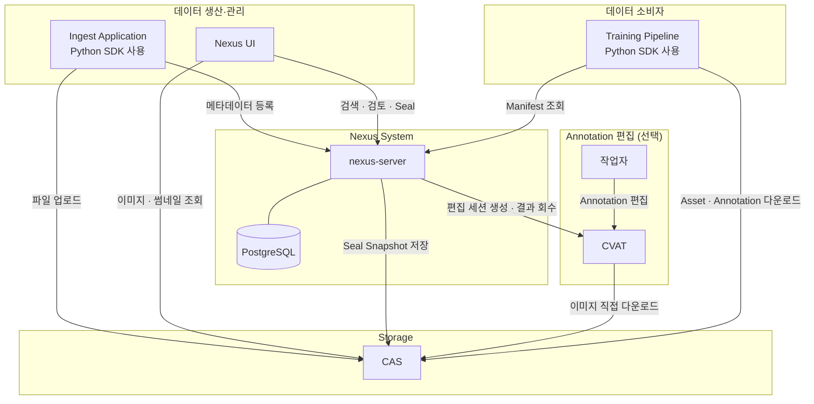
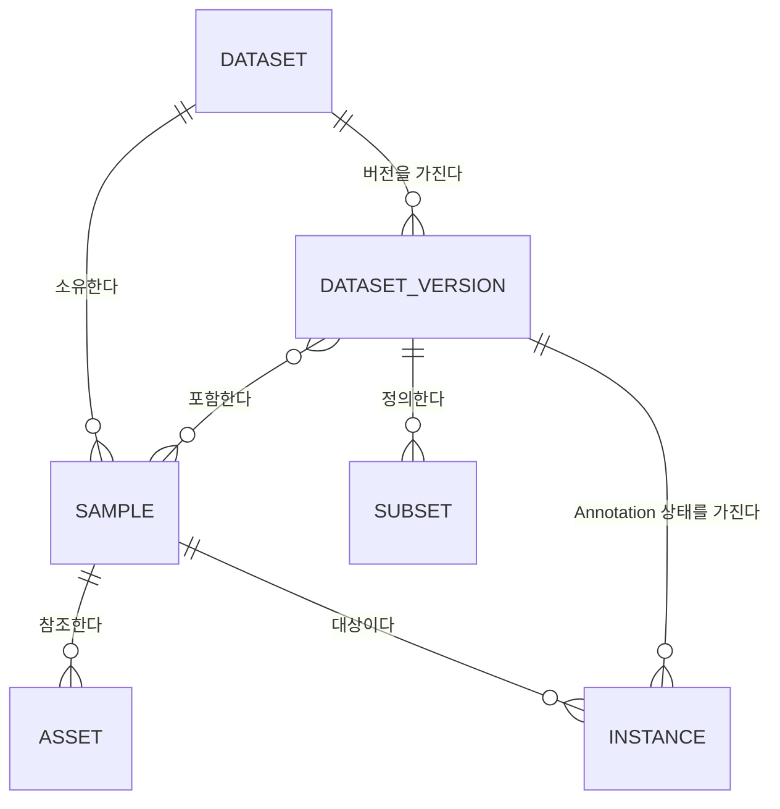
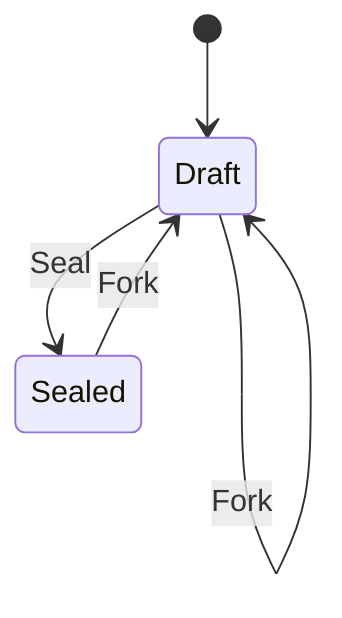
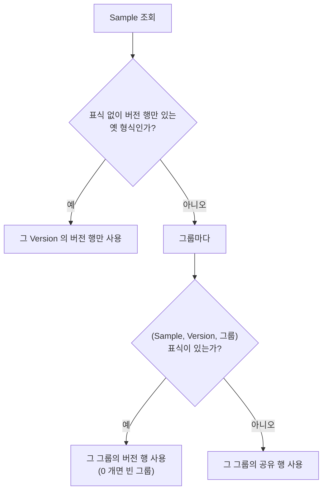
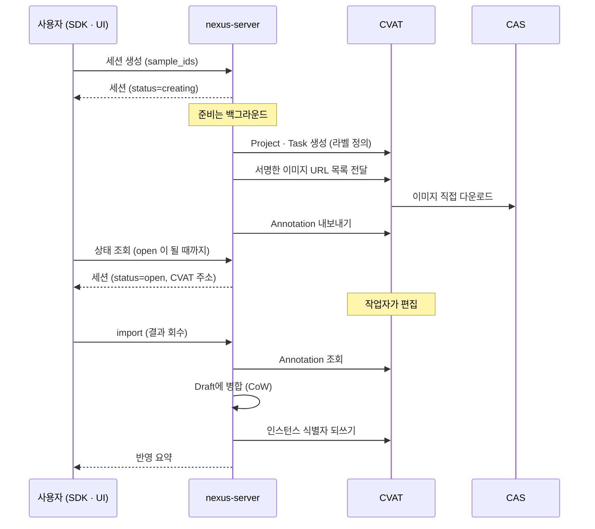
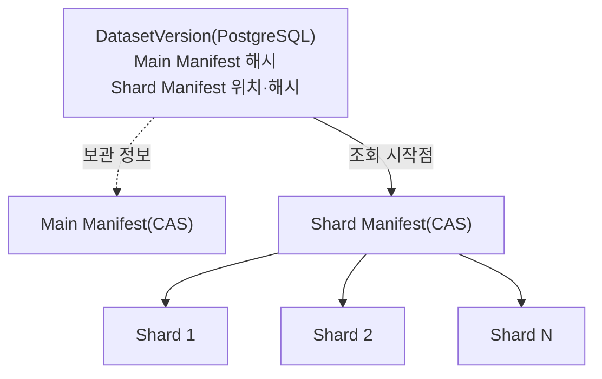
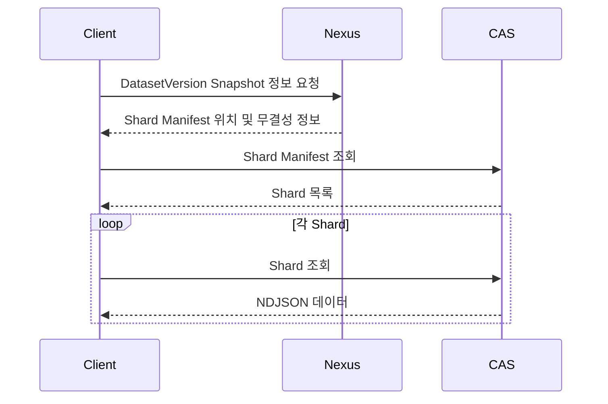
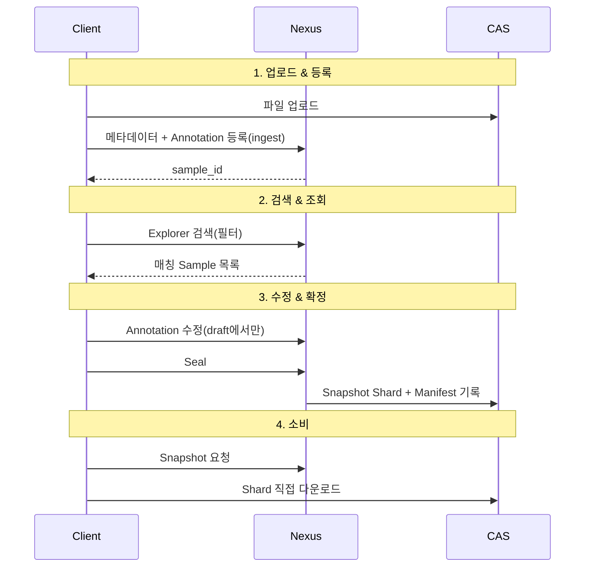

# Nexus Architecture Design
## 1. 개요
### 1.1 문제 정의
ML 학습 데이터의 규모가 증가하면서 이미지와 Annotation 파일을 디렉터리 단위로 관리하는 방식에는 다음과 같은 한계가 있다.  
- 동일한 원본 파일을 여러 데이터셋에서 사용하기 위해 데이터를 반복해서 복사해야 한다.
- Annotation 수정이나 데이터 정제 시 새로운 버전을 만들기 위해 데이터셋 전체를 다시 복사해야 한다.
- 실제 학습에 사용된 데이터셋을 추적하거나 동일한 학습 환경을 재현하기 어렵다.
- 원본 파일 관리와 데이터셋 관리가 혼재되어 저장소와 메타데이터의 책임이 명확하지 않다.  

이러한 문제는 파일 저장과 데이터셋 관리를 하나의 계층에서 처리하기 때문에 발생한다.  

Nexus는 원본 파일 저장과 데이터셋 관리를 분리하고, Dataset과 Version을 관리하는 Catalog Layer를 제공한다.

### 1.2 목표
Nexus의 목표는 다음과 같다.
- ML 학습 데이터를 Dataset과 DatasetVersion 단위로 관리한다.
- 원본 파일과 메타데이터를 분리하여 저장 공간을 효율적으로 사용한다.
- Dataset의 변경 이력을 관리하고, 동일한 학습 환경을 재현할 수 있도록 한다.
- 대규모 데이터셋을 효율적으로 탐색하고 관리할 수 있는 구조를 제공한다.
- 데이터 적재, 검색, 버전 관리를 일관된 API와 SDK로 제공한다.

### 1.3 Out of Scope
다음 기능은 Nexus의 범위에 포함되지 않는다.
- 원본 파일 저장 및 전송
- 미디어 처리(Thumbnail 생성, 이미지 변환 등) 
- 모델 학습, 평가, 추론과 같은 ML Pipeline 실행  

Nexus는 대규모 ML 데이터셋을 체계적으로 관리하기 위한 Catalog를 제공한다.  
Python SDK는 Ingest 과정을 단순화하기 위해 CAS 업로드 및 Thumbnail 생성 등의 보조 기능을 제공한다. 이는 클라이언트 측 편의 기능이며, Nexus 서버는 파일 저장이나 미디어 처리를 담당하지 않는다.

## 2. 시스템 구성
### 2.1 구성 요소
전체 시스템은 다음과 같은 구성 요소로 이루어진다.  
| 컴포넌트 |	역할 |
|---|---|
| nexus-server |	ML Dataset Catalog Server. Dataset과 Dataset Version, Sample, Annotation 등 메타데이터를 관리한다. |
| PostgreSQL |	nexus-server의 메타데이터 저장소 |
| cas-server(CAS) |	콘텐츠 주소 기반 파일 저장소. 원본 파일과 Seal된 스냅샷(NDJSON)을 저장한다. |
| Python SDK(nexus) |	Nexus와 CAS를 사용하는 공식 클라이언트 라이브러리 |
| nexus-client |	데이터 탐색, 검색 및 검토를 위한 사용자 인터페이스. |
| CVAT |	Annotation 편집기. Nexus가 편집 세션 단위로 연동하며, 이미지는 CAS에서 직접 받는다. 선택 구성 요소이다. |
| 학습 파이프라인 |	Seal된 DatasetVersion을 이용하여 학습, 평가를 수행하는 외부 시스템 |

각 구성 요소는 파일 저장, 메타데이터 관리, 사용자 인터페이스 및 학습 실행을 각각 담당하며, 서로 독립적으로 동작한다.

### 2.2 동작 흐름



Python SDK는 CAS와 Nexus를 사용하는 통합 인터페이스를 제공한다.  
원본 파일은 SDK를 통해 CAS에 업로드 되며, 메타데이터는 Nexus에 등록된다.  
데이터 검색은 Nexus에서 수행하고, 검색 결과로 반환된 파일 참조 정보를 이용하여 SDK가 CAS에서 실제 파일을 조회한다.  
이 과정에서 파일 데이터는 nexus-server를 통과하지 않는다. 따라서 대용량 파일 전송과 메타데이터 처리를 독립적으로 확장할 수 있으며, Nexus는 Dataset Catalog의 역할에 집중할 수 있다.

## 3. 도메인 모델
### 3.1 개요
Nexus는 ML 데이터셋을 Dataset, DatasetVersion, Sample, Asset, Annotation(Instance), Subset의 여섯 가지 핵심 도메인으로 관리한다.  
각 도메인은 서로 다른 책임을 가지며, 이들의 관계를 통해 하나의 ML 데이터셋과 그 버전 이력을 표현한다.


Dataset은 데이터셋의 관리 범위를 정의하며, Sample과 Dataset Version을 포함한다.  
Dataset Version은 특정 시점의 Dataset 상태를 표현하며, 여러 Sample을 포함할 수 있다.  
Sample은 하나 이상의 Asset을 가지며, Asset은 CAS에 저장된 실제 파일을 참조한다.  
Annotation Instance는 Sample에 속하며, Dataset Version별 상태로 관리된다.

### 3.2 Dataset
Dataset은 하나의 ML 프로젝트를 구성하는 최상위 관리 단위이다.  
Dataset은 Sample과 Dataset Version을 포함하는 관리 범위이다. 접근 권한은 Dataset 별로 두지 않고 계정 역할로 정한다(10장).  
하나의 Sample은 정확히 하나의 Dataset에만 속한다.

### 3.3 DatasetVersion
Dataset Version은 특정 시점의 Dataset 상태를 나타내는 논리적 스냅샷이다.  
Version에는 여러 Sample이 포함될 수 있으며, 하나의 Sample은 여러 Version에서 재사용될 수 있다.  
Version은 Draft 상태에서 수정할 수 있으며, Seal되면 불변(Immutable)이 된다.  
Version 이름은 API 경로에 그대로 쓰인다. Seal 스냅샷의 CAS key 는 이름이 아니라 바뀌지 않는 Dataset id·Version id 와 내용 해시로 만든다(서버 `0.1.24`+, [6.2](#62-shard-기반-저장)) — 이름은 Version 을 지운 뒤 같은 이름으로 다시 만들 수 있어, key 에 넣으면 서로 다른 Version 의 스냅샷이 같은 위치에 겹치기 때문이다. `0.1.23` 이하가 Seal 한 Version 의 스냅샷은 이름 기반 key(`manifests/{dataset_id}/{version}.json` 등 — 2026-07-22 이전 Seal 은 `dataset_id` 자리가 Dataset 이름 — Version 이름의 `/`는 `_`로 바뀐다)에 그대로 남는다. Version 이름 규칙은 그 key 에 맞춘 그대로 유지한다 — key가 될 수 없는 이름(`%`·백슬래시·제어문자, 지나치게 긴 이름)과 URL로 가리킬 수 없는 이름(빈 이름·공백뿐인 이름·`.`·`..`)은 만들 때 거부하고, 같은 Dataset 안에서 `/`와 `_`만 다른 두 이름(`a/b`와 `a_b`)은 공존시키지 않으며, 이미 겹친 쌍이 있으면 한쪽이 Sealed일 때 다른 쪽의 Seal을 거부한다(409 `seal_key_collision`).  
Version의 생성과 상태 변화는 다음 장에서 자세히 설명한다.

### 3.4 Sample
Sample은 학습 데이터의 기본 단위이다.  
Sample은 하나 이상의 Asset과 Annotation을 가지며, 하나의 이미지, 비디오, Point Cloud 등 하나의 학습 대상을 표현한다.  
Sample 자체는 논리적 객체이며 실제 파일은 직접 저장하지 않는다.

### 3.5 Asset
Asset은 Sample이 참조하는 실제 파일이다.  
원본 파일은 모두 CAS에 저장되며, Nexus는 CAS의 Bucket, Key, Hash 등 파일 참조 정보만 관리한다.  
하나의 Sample은 여러 개의 Asset을 가질 수 있으며, 서로 다른 역할(RGB Image, Depth Image, Point Cloud 등)을 가질 수 있다.  
Asset 은 적재할 때 함께 등록하고, 이미 적재한 Sample 에는 Draft Version 경로로 역할을 더하거나 바꿀 수 있다(`PATCH .../samples/assets`, 서버 `0.1.29`+, `image` 역할 제외). Asset 은 Version 격리 없이 Sample 에 붙으므로 그 Sample 이 든 다른 Version 의 조회에도 보인다. 그래서 Sealed Version 에 든 Sample 의 기존 역할은 바꾸지 않는다(새 역할은 더할 수 있다). 바뀐 옛 CAS 객체는 지우지 않는다.

### 3.6 Annotation(Instance)
Annotation은 Sample에 대한 Ground Truth(GT) 정보를 표현한다.  
Nexus는 미리 정의된 GT 스키마를 기반으로 Annotation을 관리하며, Instance를 Annotation의 최소 저장 단위로 사용한다.  
하나의 Instance는 id와 label 등의 공통 정보를 가지며, 하나 이상의 Annotation Component(keypoint_2d, bounding_box, cuboid_3d, polygon, polyline, mask 등)를 포함할 수 있다. 2D Component(`keypoint_2d`·`bounding_box`·`polygon`·`polyline`)는 정규화 좌표, 3D Component(`cuboid_3d`·`keypoint_3d`)는 미터 단위 카메라 좌표이고, `mask`(COCO 압축 RLE)만 픽셀 단위다.  
Annotation은 Dataset Version별 변경 사항을 효율적으로 관리하기 위해 Copy-on-Write(CoW) 방식을 사용한다. 자세한 Version 관리 방식은 5장에서 설명한다.

### 3.7 Subset
Subset은 Dataset Version에 저장되는 필터 조건이다.  
Train, Validation, Test와 같은 데이터 분할뿐 아니라 특정 조건으로 검색한 결과를 재사용하기 위한 논리적 집합을 표현한다.  
Subset은 Sample을 별도로 복사하지 않으며, 저장된 필터를 통해 필요한 Sample 집합을 재구성한다.

## 4. Dataset Version Lifecycle
### 4.1 개요
Dataset Version은 Dataset의 특정 시점을 나타내는 논리적 스냅샷이다.  
Version은 Draft 상태에서 생성되어 자유롭게 수정할 수 있으며, Seal되면 불변(Immutable)이 된다. Seal된 Version은 이후의 학습, 평가 및 재현에 사용된다.  
Version의 상태는 다음과 같은 생명주기를 따른다.


### 4.2 Draft Version
자유롭게 수정 가능한 작업 중 상태.  
- Sample 추가 및 제거
- Annotation 수정
- 다른 Version의 Sample 연결(Link)
- 다른 Dataset으로부터 Sample 가져오기(Import)  

등 모든 편집 작업이 가능하다.

### 4.3 Seal
Seal은 Draft를 변경 불가능한 DatasetVersion으로 확정하는 과정이다.  
Seal이 완료되면
- 그 Version 의 구성과 Annotation 을 바꾸는 요청이 409 로 거부된다. 그 Version 에 속한 Sample 자체의 삭제도 409 다.
- Snapshot(Manifest)이 생성된다.
- 이후 학습과 평가의 기준이 된다.  

Seal 은 Version 하나를 통째로 읽어 직렬화하므로 메모리를 가장 많이 쓰는 작업이다. 그래서 서버는 파드마다 동시에 도는 Seal 수에 상한(`seal.maxConcurrent`, 기본 1)을 두고, 같은 Version 의 Seal 은 DB 잠금으로 파드와 무관하게 하나만 돌린다(서버 `0.1.21`+). 판정 순서는 이미 Sealed 인가(409 `already_sealed`) → 같은 Version 의 Seal 이 도는가(429 `seal_in_progress`) → 파드 상한이 찼는가(429 `seal_busy`)이다. 넘친 요청은 기다리게 하지 않고 시작하지 않은 채 `429`(`Retry-After: 10`)로 돌려보낸다 — 기다리게 하면 프록시의 응답 대기 상한에 먼저 걸리고, 시작하지 않았으므로 다시 보내도 중복되지 않는다. 진행 중 거절을 `409` 가 아니라 `429` 로 내는 것은 `409` 가 「이미 Sealed」의 뜻으로 쓰이고 있기 때문이다.

Seal 은 요청과 분리된 태스크로 돈다. 클라이언트나 프록시가 연결을 끊어도 Seal 은 끝까지 진행되고, 끊긴 쪽은 Version 상태를 조회해 결과를 확인한다. 도는 중인 Seal 은 Version 조회에 `seal_in_progress`(와 시작 시각 `seal_started_at`)로 보인다(서버 `0.1.25`+) — 같은 Version 잠금을 DB 에서 보므로 어느 파드가 돌리든 보이고, Seal 이 실패하거나 파드가 죽으면 잠금과 함께 사라진다. 같은 Version 잠금은 Seal 이 끝날 때까지 커넥션 하나를 쥔다(Postgres 에서는 `idle in transaction` 으로 보인다). 서버 종료(SIGTERM)는 연결이 끊긴 채 도는 Seal 을 기다리지 않으므로 그 Seal 은 Draft 로 남는다 — Version 을 Sealed 로 바꾸는 쓰기가 맨 마지막이라 반쯤 Sealed 인 상태는 없다.

Seal 은 마지막 트랜잭션에서 그 Version 의 샘플 수(삭제되지 않은 Sample)를 세어 저장하고, Version 을 돌려주는 응답(Version 조회·목록·설명 수정·Seal)은 Sealed Version 에 그 값을 `sample_count` 로 싣는다(서버 `0.1.24`+). Draft Version 의 수는 저장하지 않는다 — 적재·링크·삭제마다 증감이 필요하고 병렬 적재가 Version 행 하나에서 줄을 서게 되기 때문이다. 이 값은 API 조회(Explorer 개수, Manifest 조회의 `sample_count`)와 같은 수이고, 스냅샷의 수(Shard Manifest 의 `total_samples`)와는 다를 수 있다 — 샤드를 만든 뒤 Seal 이 끝나기 전에 지워진 Sample 은 스냅샷에만 있고, 그 사이 더해진 Sample 은 저장된 수에만 있을 수 있다.

Seal 과정에서 생성되는 Snapshot 구조는 6장에서 설명한다.

### 4.4 Fork
Sealed Version은 직접 수정할 수 없다.  
기존 Version을 변경하려면 새로운 Draft Version을 생성(Fork)하여 작업한다.  
새 Draft는 부모 Version의 Sample 구성을 그대로(또는 지정한 Sample만) 이어받으며, 이후 필요한 Sample과 Annotation만 변경한다.  
이를 통해 이전 Version은 그대로 유지되며 새로운 Version만 변경된다.  
Annotation 은 부모의 Version 전용 행과 그룹 표식을 함께 복사하고 공유 행은 복사하지 않는다(부모가 옛 형식이면 자식에 표식을 새로 넣는다, §5.2).  
Version 설명은 Fork 로 이어받지 않는다 — 설명은 그 Version 에 대한 메모이고 새 Draft 는 다른 Version 이다(Fork 요청에 새 설명을 줄 수는 있다).
 
### 4.5 버전 불변성
Seal된 Version은 변경되지 않는다.  
단 Version 설명(`description`)은 예외다 — 메모라 Manifest 와 그 해시에 들어가지 않으므로 Sealed Version 에서도 고칠 수 있고 재현성에 영향이 없다(§4.8).  
- 동일 Version 은 언제나 동일한 데이터셋을 의미하며,
- 언제든 동일한 학습 환경을 재현할 수 있다.  

새로운 데이터셋을 만들기 위해서는 기존 Version을 수정하는 대신 새로운 Draft Version을 생성한다.

### 4.6 삭제와 저장소 정리
Draft Version 은 `editor` 이상의 사람 계정이 `?confirm=<버전>` 을 정확히 붙여 삭제할 수 있다(로봇 계정은 403). 그 Version 에 열린 CVAT 편집 세션(`creating`·`open`)이 있으면 409 다 — 지우면 아직 들이지 않은 편집이 사라지므로, 세션을 닫거나 지운 뒤 다시 부른다(서버 `0.1.26`+). **Sealed Version 은 기본적으로 삭제할 수 없다** — `confirm` 을 맞게 준 요청도 관리자가 아니면 409로 거부되며(`confirm` 이 없거나 틀리면 역할과 무관하게 400), Dataset 의 마지막 Version 이어서 Dataset 까지 함께 사라지는 경우에도 마찬가지다.  
**단 관리자(`role=admin`인 사람 계정 — 설정 superuser 는 기동 시 `admin` 이 부여된다)는 Sealed Version 을 삭제할 수 있다** — `DELETE /datasets/{id}/versions/{v}` 에 쿼리 파라미터 둘, `?confirm=<버전>` 과 `?confirm_dataset_name=<데이터셋명>` 을 정확히(비어 있지 않게) 함께 줄 때만이다. 하나라도 틀리면 지우지 않는다. **되돌릴 수 없다.** `editor`·`viewer`·로봇은 지울 수 없다. 재현성 보호의 축은 여전히 Seal 이고(§10.3), 관리자에게만 복구(break-glass) 경로를 연 것이다.  
마지막 Draft Version 이 삭제되고, 해당 Dataset에 남은 Version 이 없다면 Dataset 도 함께 삭제된다(관리자가 마지막 Sealed Version 을 위 절차로 지우는 경우도 같다).
Dataset 을 버전째 한 번에 지우는 `DELETE /datasets/{id}?confirm_dataset_name=<데이터셋명>`(서버 `0.1.26`+)은 Version 마다 위 규칙으로 지운다. 지우기 전에 이름 → 역할·로봇 → Sealed Version(관리자가 아니면 409) → Seal 이 진행 중인 Version(409) → 열린 CVAT 세션(409)을 모두 보고, 걸리면 아무것도 지우지 않는다. Version 하나씩 지우므로 Dataset 전체로는 원자적이지 않다 — 도중에 멈추면 다시 불러 남은 Version 부터 지운다.  
이때 삭제 요청에 `delete_cas=true`를 명시적으로 지정한 경우에만, 더 이상 어디에서도 참조되지 않는 **Sample 원본 파일**(Asset)에 대해 CAS에 삭제 요청을 보내 CAS 내부 GC 로직에 의해 정리될 수 있도록 한다. `delete_cas`는 기본값이 `false`(보존)이므로, 별도로 지정하지 않으면 Asset 객체는 그대로 남는다. `delete_cas` 는 Asset 만 정하고 Seal 스냅샷에는 관여하지 않는다(아래).  
**Seal 스냅샷 객체(샤드 NDJSON·Shard Manifest·Main Manifest)는 별도 표(`dataset_version_objects`)가 정한다**(서버 `0.1.24`+, [6.3](#63-manifest-구조)). Version 을 지우면 **`delete_cas` 와 무관하게** 그 표에 기록된 객체를 모두 지운다(서버 `0.1.31`+ — 그 전에는 Sealed 스냅샷을 `delete_cas=true` 일 때만 지웠다). 표에 Sealed 스냅샷 기록이 없는 Sealed Version 은 `0.1.23` 이하가 Seal 한 옛 형식으로 보고, 이름 기반 Manifest key 둘을 지운다. 단 같은 Dataset 의 다른 살아 있는 옛 형식 Sealed Version 이 같은 key 를 쓰면 그 key 는 남긴다.

| 객체 | Version 삭제 시(`delete_cas` 무관) |
|---|---|
| 끝나지 않은 Seal 이 남긴 객체(실패·중단·경합에서 진 Seal 의 잔여) | 지운다 |
| Sealed 스냅샷 — `0.1.24`+ 가 Seal 한 Version(Version 전용 key) | 샤드·Shard Manifest·Main Manifest key 를 모두 지운다 |
| Sealed 스냅샷 — `0.1.23` 이하가 Seal 한 Version(이름 기반 key) | 그 Version 의 Manifest 둘을 지운다(같은 key 를 쓰는 다른 살아 있는 옛 형식 Sealed Version 이 있으면 남긴다). 샤드는 내용 주소로 다른 Version 과 공유될 수 있어 남긴다. 단 2026-07-22 이전에 Seal 한 Version 의 Main Manifest 는 key 가 Dataset 이름 기반이라 지워지지 않는다 |

nexus 가 지우는 것은 CAS 의 **key** 다. 물리 blob 은 그 내용을 가리키는 살아 있는 key 가 없을 때 CAS GC 가 회수하므로, 다른 Version 이 같은 내용을 자기 key 로 올렸으면([6.2](#62-shard-기반-저장)) blob 은 남는다. 스냅샷을 `delete_cas` 와 무관하게 지우는 것은 스냅샷이 Seal 이 만든 파생물이기 때문이다 — 그것을 가리키는 기록(`dataset_version_objects`·`dataset_versions`)이 Version 과 함께 사라지므로, 남기면 nexus 로는 다시 읽을 길이 없고 누수와 구분되지 않는다. `delete_cas` 는 사용자가 올린 Sample Asset 만 정한다. **잃는 것:** Manifest 조회로 받은 CAS 위치를 따로 적어 두고 직접 읽던 외부 기록은 그 Version 을 지우면 더 이상 읽히지 않는다 — 재현이 필요한 Version 은 지우지 않는다. 그 전 서버에서 `delete_cas=false` 로 지운 Version 이 남긴 스냅샷과 어느 Version 도 가리키지 않는 옛 형식 샤드·Manifest 는 `nexus-server reconcile-snapshots --apply` 로 지운다(대상의 예외는 차트 README 「스냅샷 잔여 점검」). Version 행을 지우는 다른 경로(Clone 롤백)도 같은 규칙을 지난다.  
원본을 지울 때 그 썸네일(`thumb/<key>`)도 함께 지우는데, 에셋 role 과 무관하게 **원본 삭제가 성공했을 때만** 지운다(서버 `0.1.23`+). 삭제는 요청 연결이 끊겨도 DB 삭제와 CAS 정리를 끝까지 하고(서버 `0.1.23`+, Seal 과 같은 구조), 지우지 못한 객체 수는 지표 `nexus_cas_delete_failures_total` 로 보인다.

### 4.7 Clone (비동기 복제)
Fork 가 같은 Dataset 안에서 새 Version 을 만드는 것이라면, Clone 은 (Dataset, Version) 을 **새 Dataset** 으로 통째 복제한다. `POST /datasets/{id}/versions/{version}/clone-jobs` 가 job 을 만들고 즉시 201 을 반환하며, 실제 복사는 백그라운드에서 진행된다 — 대규모 Dataset 을 동기로 복사하면 프록시 타임아웃에 걸리기 때문이다(CVAT 세션과 같은 구조). 진행 상태는 `GET /clone-jobs/{job_id}` 로 폴링하고(`copied_count`/`total_count`), `DELETE /clone-jobs/{job_id}` 로 협조적으로 취소한다(다음 청크 경계에서 멈춘다). 대상은 원본 Dataset 의 tags/description·그룹 종류 선언과 원본 Version 의 설명을 복사하고 항상 Draft 로 시작하며, Asset 참조(bucket/key/hash)는 재사용하므로 CAS 재업로드 없이 Sample·Sample Asset·Instance 행만 복제된다. 실패·취소, 그리고 재시작으로 중단된 job 모두 만들던 대상 Dataset 을 롤백한다. 중단된 job(진행이 10분 넘게 멈춘 job)의 정리는 주기 태스크가 하며(기동 직후 한 번, 이후 5분마다) 서버 기동을 기다리게 하지 않는다 — 대형 대상의 롤백이 startupProbe 예산을 먹지 않게 하기 위해서다. 롤백은 대상이 **job 이 만든 모양 그대로(Draft Version 하나, 또는 아직 Version 없음)일 때만** 한다 — 복사 중에도 대상은 보통의 Draft Dataset 이라, 그 사이 누가 Seal 했거나 Version 을 붙였으면 지우지 않고 남긴다(Sealed 보호를 우회하지 않기 위해서다). 롤백을 거부했거나 실패하면 그 사유를 job 에 기록한다. 복제 도중 원본 Sample 이 삭제되면 job 은 실패로 끝나고 대상을 롤백한다 — 원본 Sample 을 잠근 뒤 Asset 을 읽으므로, 삭제된 원본의 CAS 객체를 가리키는 대상이 만들어지지 않는다(서버 `0.1.23`+, 동기 `samples/import` 는 400). 서버 부하 방어를 위해 동시 실행 job 수에 전역 상한을 둔다(초과 시 409 가 아니라 429). 생성·취소는 `editor` 이상, 조회는 로그인한 사용자면 된다.

### 4.8 Version 설명
Version 마다 설명(`description`, 최대 10,000 자) 하나를 둔다(서버 `0.1.21`+). Version 을 만들 때, Seal 할 때(Seal 이 성공할 때만 기록된다), 그리고 `PATCH /datasets/{dataset_id}/versions/{version}` 으로 쓰고, `null`·빈 문자열은 지움이다. 설명은 메모다 — Manifest 와 그 해시에 들어가지 않으므로 **Sealed Version 에서도 고칠 수 있고** 재현성에 영향이 없다. 쓰기 권한은 다른 카탈로그 쓰기와 같이 `editor` 이상이다(로봇 포함). Fork 는 설명을 복사하지 않고 Clone 은 복사한다. Seal 과 Version PATCH 두 경로만 요청 본문 상한이 256 KiB 다(넘으면 413).

## 5. Annotation Versioning
### 5.1 개요
Nexus는 Sample과 Annotation을 서로 다른 방식으로 Version 관리한다.  
Sample은 Version 간에 공유되며, Annotation만 Version 별로 독립적으로 관리한다. 이를 위해 Annotation에는 Copy-on-Write(CoW) 방식을 적용하여, 변경이 발생한 Annotation만 새로운 Version에 저장한다.  
이러한 구조를 통해 Version 간 중복 저장을 최소화하면서도, 각 Version의 독립성과 재현성을 유지한다.

### 5.2 Copy-on-Write
Ingest 로 적재된 Annotation 은 모든 Version 이 공유하는 공유(base) Instance(공유 행)이다. CoW 의 단위는 **(Sample, 그룹)** 이다(서버 `0.1.29`+). Version 에서 Sample 의 그룹 하나를 고치면 그 그룹만 그 Version 전용 Instance(버전 행)로 쓰고, 표식 표 `instance_overrides` 에 (Sample, Version, 그룹) 표식을 남긴다. 그 Version 에서는 표식이 있는 그룹만 버전 행이 공유 행을 가리고, 고치지 않은 그룹은 계속 공유 행을 읽는다.  
Fork 시 부모 Version 의 버전 행과 표식이 새 Version 으로 함께 복사되고, 공유 행은 복사 없이 계속 공유된다. 수정되지 않은 Sample·그룹은 저장 공간을 더 쓰지 않는다. 부모가 옛 형식(표식 없이 버전 행만 있음)인 Sample 은 자식에 모든 그룹의 표식을 새로 넣어 그룹 단위로 만든다 — 자식이 읽는 내용은 부모와 같다(서버 `0.1.30`+).

쓰기에는 두 모드가 있다.

- **그룹 모드** — 그 Sample 을 읽는 Version 이 둘 이상이거나 이 Version 에 그 Sample 의 버전 행·표식이 이미 있으면, 바뀐 그룹의 버전 행과 표식을 쓴다. 그룹을 비우면 버전 행 0 개 + 표식이 남아 「이 Version 에서 그 그룹은 비어 있음」을 표현한다(공유 행이 되살아나지 않는다).
- **직접 모드** — 그 Sample 을 읽을 수 있는 Version 이 이 Draft 하나뿐이고 이 Draft 에 그 Sample 의 버전 행·표식이 아직 없으면, 버전 행을 만들지 않고 공유 행을 바로 고친다. 다른 Version 이 없으니 가릴 대상이 없기 때문이다. 「읽을 수 있는 Version」은 그 Sample 이 링크된 Version, 그 Sample 의 버전 행이 남은 Version, 그 Sample 의 표식이 남은 Version 을 합친 것이다 — 링크를 끊었어도(unlink) 그 Sample 을 고친 적이 있어 행·표식이 남은 Version 은 센다. 직접 모드에서 그룹을 비우면 공유 행이 지워진다. 직접 모드로 고친 Sample 은 적재 때의 Annotation 을 남기지 않으므로, 이후 다른 Version 에 링크해도 고친 값이 보인다.

어느 모드든 **바뀐 그룹만 쓴다** — 쓰기 결과를 그룹마다 지금 값과 비교해(GT 의 `id`·`label`·`track_id`·`confidence`·컴포넌트를 보고 서버 내부 `instance_id` 는 보지 않는다. `confidence` 는 비트로 비교해 `-0.0` 과 `0.0` 을 다르게 본다) 다른 그룹만 쓰므로, 바뀌지 않은 그룹의 내부 `instance_id` 가 다시 발급되지 않는다. 쓰기 모드별 횟수는 지표 `nexus_annotation_instance_writes_total{mode}` 로 보인다.

표식 표가 생기기 전에 쓰인 Sample(표식 없이 버전 행만 있는 옛 형식)은 그 Version 에서 버전 행만 읽는다(옛 규칙). 그런 Sample 은 처음 쓸 때, 그 Version 을 Fork 할 때(자식 쪽), 또는 버전 행 정리 때 모든 그룹에 표식을 넣어 그룹 단위로 바뀐다(읽는 내용은 같다).

운영자가 실행하는 서브커맨드 `nexus-server compact-instances`(서버 `0.1.30`+, 기본 dry-run, 차트 README 「annotation 버전 행 정리」)는 어느 Version 이 읽는 내용도 바꾸지 않는 범위에서 행을 줄인다 — 읽히지 않는 버전 행과 공유 행과 같은 버전 행은 지우고, 그 Sample 을 읽는 Version 이 링크된 하나뿐이면 버전 행을 공유 행으로 옮기며, 읽는 모든 Version 이 표식으로 덮은 공유 행은 지운다. 정리 뒤에는 Version 조회의 내부 `instance_id` 가 바뀔 수 있고(내용은 같다), Version 을 지정하지 않은 `GET /instances` 의 행이 바뀌며, 정리된 Sample 을 Fork 없이 다른 Version 에 링크하면 적재 때 값이 아니라 옮긴 Version 의 값을 본다. 되돌릴 수 없다(undo 기록으로만 손으로 복구한다).

```
Version A

Sample 1
 └── Annotation
      ├── det   (공유 행)
      ├── pose  (공유 행)
      └── lane  (공유 행)

           Fork → Version B 에서 det 만 수정

Version B

Sample 1
 └── Annotation
      ├── det'  (Version B 버전 행 + 표식)
      ├── pose  (공유 행, A 와 같은 행)
      └── lane  (공유 행, A 와 같은 행)
```

### 5.3 버전별 조회
Annotation을 조회할 때는 그룹마다 현재 Version의 표식을 보고, 표식이 있으면 그 Version의 버전 행을, 없으면 공유 행을 읽는다.  
이 과정에서 변경되지 않은 그룹은 여러 Version에서 공유하면서도, 각 Version은 독립적인 Annotation 상태를 유지할 수 있다.



Version 을 지정하지 않은 Instance 조회(`GET /instances`)는 이 해소를 거치지 않은 저장된 행 그대로다 — 직접 모드가 고친 공유 행이 보이고 표식은 나타나지 않는다. Version 에서 보이는 결과는 `?dataset_version_id=` 로 조회한다.

### 5.3.1 Annotation 쓰기 — 통째 교체(PUT)와 부분 저장(PATCH)
Annotation 쓰기에는 두 가지가 있다.

- **통째 교체(`PUT .../samples/{sample_id}/annotations`)** — 보낸 그룹들로 이 Version 의 그 Sample Annotation 전체를 바꾼다. 보내지 않은 그룹은 사라지고, `meta` 를 보냈으면 그 값으로 통째로 바뀐다(보내지 않으면 그대로). 단 **그룹을 하나도 보내지 않으면 Instance 는 건드리지 않는다.**
- **부분 저장(`PATCH` 같은 경로)** — 보낸 그룹만 통째로 바꾸고 나머지 그룹은 그대로 둔다. `meta` 는 top-level 키 단위로 합친다(값이 `null` 인 키는 지운다).

CoW 가 (Sample, 그룹) 단위이므로(§5.2) 부분 저장은 보낸 그룹 중 바뀐 그룹만 쓰고, 보내지 않은 그룹은 옮겨 적지 않는다. 통째 교체는 보내지 않은 그룹을 비우는 것으로 보므로 그 그룹도 바뀐 그룹이 된다.

두 쓰기 모두 형식이 어긋난 입력은 요청 전체를 400 으로 거절하고 아무것도 쓰지 않는다(서버 `0.1.30`+). 대상은 `meta` 가 아닌 최상위 키의 값이 배열이 아닌 경우(`null` 포함), 그룹 원소가 객체가 아니거나 문자열 `label` 이 없는 경우, 그리고 공통 필드 `id`(문자열)·`track_id`(32 비트 정수)·`confidence`(32 비트 실수)의 타입·범위 위반이다(`null`·키 없음은 값 없음). 보낸 그룹은 교체되므로 버린 원소만큼 기존 Instance 가 지워지기 때문이다. 오류 문구는 첫 위반 하나와 그 위치다. 응답의 `skipped` 는 호환용으로 남아 늘 0 이다.

그룹을 비우는 저장은 결과가 모두 비어도 받는다. 그룹 모드에서는 표식이 「이 Version 에서 비어 있음」을 표현하므로 공유 Instance(적재한 GT)가 되살아나지 않고, 직접 모드에서는 공유 행을 지운다(그 Sample 을 읽는 Version 이 하나뿐이라 되돌릴 대상이 없다).

한 Sample 에 대한 쓰기(PUT·PATCH·CVAT 반영)는 그 Sample 행을 잠그고 한 트랜잭션으로 적용되므로 차례로 반영된다. 두 곳에서 같은 Sample 의 서로 **다른** 그룹을 부분 저장해도 서로 지우지 않는다. 단 이 보장은 부분 저장끼리만이다 — PUT·CVAT 반영은 보낸 내용을 그 Sample 의 Annotation 전체로 보므로, 그 사이 다른 곳에서 바뀐 그룹을 자기가 읽은 값으로 되돌릴 수 있다.

### 5.4 Sample은 CoW를 사용하지 않는다
Copy-on-Write는 Annotation에만 적용된다.  
Fork 시 새로운 Version의 Sample 멤버십이 생성되며, 각 멤버십은 동일한 Sample을 참조한다.   
이러한 구조를 통해 특정 Version에 어떤 Sample이 포함되어 있는지를 단순한 조회만으로 확인할 수 있으며 Version별 Sample 구성도 독립적으로 관리할 수 있다.  
이는 저장 공간의 일부 증가를 감수하더라도, Version 조회 성능과 데이터 모델의 단순성을 우선한 설계이다.

### 5.5 Annotation 편집 — CVAT 연동
Nexus는 Annotation을 직접 편집하는 도구를 제공하지 않고, 편집이 필요한 경우 외부 편집기인 CVAT과 **편집 세션(Annotation Session)** 단위로 연동한다.
세션은 Draft Version의 Sample 집합을 CVAT으로 내보내고, 작업자가 편집한 결과를 다시 Draft에 병합하는 왕복 과정을 하나의 단위로 묶은 것이다.

세션 1개는 CVAT의 Project 1개와 Task 1개에 대응한다.
Sealed Version은 편집 대상이 될 수 없으며, 세션 생성 요청은 거부된다.

#### 5.5.1 데이터 흐름
이미지 파일은 Nexus를 통과하지 않는다. Nexus는 CAS Object의 URL 목록만 CVAT에 전달하고, CVAT이 CAS에서 직접 이미지를 내려받는다. URL에는 서버 키로 GET 서명(만료 기본 1시간)을 붙이므로 CAS가 익명 읽기를 닫은 배포에서도 받을 수 있다(서버 `0.1.25`+). 서명한 URL은 CVAT 쪽에 저장된다. 파일 이름이 겹치거나 서명한 URL이 CVAT의 저장 한도(1024 자)를 넘는 Sample이 있으면 CVAT Project를 만들기 전에 세션을 실패시킨다.
Nexus가 주고받는 것은 Annotation과 라벨 정의뿐이다.



세션 생성은 비동기로 처리된다. CVAT이 이미지를 모두 내려받아야 편집을 시작할 수 있고 그 시간이 Sample 수에 비례하므로, Nexus는 세션을 먼저 반환하고 준비는 백그라운드에서 진행한다.
클라이언트는 세션 상태가 `open`이 될 때까지 조회한다.

| 상태 | 의미 |
|---|---|
| `creating` | CVAT Project·Task 준비 중. 아직 편집할 수 없다 |
| `open` | 편집 가능 |
| `closed` | 작업 종료. Sample 잠금이 해제된 상태 |
| `failed` | 준비 실패. 사유가 함께 기록된다 |

준비 작업은 진행 중임을 60 초마다 세션에 기록한다. 각 파드는 5 분마다(기동 직후 포함) 이 기록이 `cvat.staleCreatingSecs`(기본 1800 초, 하한 180 초)보다 오래 멈춘 `creating` 세션을 `failed` 로 바꾼다(서버 `0.1.21`+). 판정이 생성 시각이 아니라 진행 기록이므로 다른 파드가 지금 준비 중인 세션은 건드리지 않고, 파드 교체로 준비가 끊긴 세션은 다음 재기동을 기다리지 않고 정리된다. 정리는 조건부 UPDATE 하나라 여러 파드가 동시에 돌려도 한 번만 적용된다.

#### 5.5.2 편집 범위
CVAT은 2D 이미지 편집기이므로, 왕복이 무손실인 컴포넌트만 내보낸다.

| 구분 | 컴포넌트 | 처리 |
|---|---|---|
| 편집 대상 | `bounding_box`, `polygon`, `polyline`, `keypoint_2d`, `mask` | CVAT으로 내보내고 편집 결과를 병합한다 |
| 편집 제외 | 그 밖의 모든 컴포넌트(`cuboid_3d`, `keypoint_3d`, classification 등) | 내보내지 않으며 **원본이 그대로 보존된다** |

`keypoint_2d`는 CVAT의 skeleton 라벨로 나간다. 관절 **이름**과 **연결선**은 서버가 만들어 내는 값이 아니라 GT의 `meta.keypoint_info`에서 온다 — 컴포넌트 키로 색인된 `{labels, edges}`다(세션 생성의 `extra_labels` 로 만든 skeleton 은 이름을 요청의 `keypoints` 에서 받고 연결선만 `keypoint_info[<component_key>]` 에서 읽는다, 서버 `0.1.26`+). `edges`의 원소는 두 점의 쌍이 아니라 여러 점을 잇는 **경로**이며, 서버가 그것을 연결선 쌍으로 펴서 skeleton SVG에 넣는다. 이 값이 없거나 이름 배열만 있는 옛 모양이면 연결선 없이 점만 그려진다. 관절 수 밖을 가리키는 인덱스는 그 선만 건너뛴다 — 그리면 CVAT이 project 생성을 거절해 세션이 통째로 실패하고 사유가 드러나지 않는다.

편집 대상이 아닌 컴포넌트는 병합 과정에서 변경되지 않는다. 3D 정보나 분류 값을 가진 인스턴스의 2D 박스만 수정하는 경우에도 나머지 정보는 유지된다.

`mask` 는 COCO 압축 RLE(`rle: {size: [높이, 너비], counts}`, 열 우선)이고 GT 에서 유일하게 픽셀 단위다(서버 `0.1.29`+). CVAT 의 mask 는 행 우선 런과 양끝을 포함한 경계 상자로 저장되므로 내보낼 때와 들일 때 바꾼다. 내보내기 전에 넓이(5,000 만 화소 상한)·`size` 와 Sample 의 `meta.height/width` 일치·런 합·전경 유무를 검사하고, 어긋나면 내보내지 않고 원본을 보존한다 — 몇 글자짜리 `counts` 로 큰 메모리를 할당시키는 입력을 디코드 전에 막기 위해서다. 들일 때의 변경 판정은 좌표가 아니라 픽셀 비교라, CVAT 이 경계를 다시 잘라 돌려줘도 같은 픽셀이면 쓰지 않는다.

신원이 남은 도형의 종류가 원본 컴포넌트 타입과 다르면(주석 파일을 고쳐 올린 경우 등) 기하를 반영하지 않고 원본을 유지하며 경고한다(서버 `0.1.29`+). 라벨 변경은 반영한다.

CVAT 에서 새로 그린 도형(nexus 신원이 없는 것)은 새 인스턴스가 되고, 컴포넌트 키는 그 라벨의 것이다 — 고른 샘플의 점에서 만든 skeleton 이면 그 점의 컴포넌트 키, `extra_labels` 의 skeleton 이면 `component_key`, 도형 라벨이면 도형 타입이다. 신원 없는 새 도형은 CVAT `group` 번호(0 이 아닌 값)가 같으면 인스턴스 하나로 묶고 도형마다 컴포넌트 하나가 된다(서버 `0.1.29`+). 인스턴스 `label` 은 그 라벨의 인스턴스 라벨이다 — `extra_labels` skeleton 항목의 `instance_label`(생략하면 `label`)이고, CVAT 라벨 이름과 인스턴스 라벨을 갈라 「`person` 인스턴스의 `person-body` 점」을 표현한다. skeleton 라벨의 단위는 (group, 인스턴스 라벨, 컴포넌트 키)이고 같은 단위에서는 `extra_labels` 가 관측보다 우선한다. 라벨 투표는 인스턴스 라벨로 한다. 신원 있는 도형과 같은 번호의 새 도형은 기존 인스턴스에 합류하지 않는다 — 세션이 붙이는 번호와 자동 라벨링의 group 번호가 같은 정수 공간이라서다. 들이지 않는 도형 종류(ellipse·cuboid·skeleton 이 아닌 points 등)는 종류별 개수를, 형식 오류 도형은 도형마다 한 줄과 개수 한 줄을 경고하고, 묶음 판정 전에 빼므로 같은 번호의 다른 도형을 쪼개지 않는다. CVAT 라벨 이름이 겹치는 세션은 CVAT Project 를 만들기 전에 실패시킨다.

CVAT **트랙**(rectangle·polygon·polyline·skeleton)은 「가져오기」가 키프레임과 보간 프레임을 프레임별 인스턴스로 펼쳐 들인다(서버 `0.1.27`+). REST 가 키프레임만 주므로 보간은 nexus 가 CVAT `v2.78.0` 의 `TrackManager` 규칙을 옮겨 계산하고, `outside`·삭제 프레임에는 인스턴스를 만들지 않는다. 한 트랙은 모든 프레임에서 같은 인스턴스 `id`·`track_id` 이고, `track_id` 는 nexus 가 `(버전, meta.sequence_id)` 안에서 0 부터 발급한다. CVAT 트랙 id → `(id, sequence_id, track_id)` 는 세션별 표 `annotation_session_tracks` 가 지고 CVAT 에 되쓰지 않는다 — 이 표 하나로 다음 「가져오기」가 같은 값을 받는다. 시퀀스 하나에 들지 않는 트랙은 들이지 않고, 앞서 들인 트랙을 이번에 들이지 못하면 기존 인스턴스를 지우지 않는다. 단 모든 프레임이 `outside`(또는 삭제 프레임)인 트랙은 작업자가 지운 것으로 보고 그 인스턴스를 지운다. 트랙에서 나온 컴포넌트에는 `keyframe`(bool)이 붙는다(GT 스키마의 편집형 네 컴포넌트에 선택 필드로 선언). job 경계에서 CVAT 이 둘로 저장한 트랙은 합치지 않는다. points·ellipse·cuboid·mask 트랙은 들이지 않는다.

#### 5.5.3 인스턴스 식별
왕복 과정에서 Nexus 인스턴스와 CVAT Shape를 연결하기 위해, Nexus는 인스턴스 식별자를 CVAT Shape의 속성(attribute)으로 함께 내보낸다.
편집 결과를 회수할 때 이 값으로 원본 인스턴스를 찾아 병합한다.

다만 CVAT은 Shape의 라벨을 변경하면 속성 값을 초기화한다. 이 경우 식별자가 사라져 원본 인스턴스를 찾을 수 없게 되므로, Nexus는 세션마다 **CVAT Shape ID와 인스턴스 식별자의 매핑을 함께 보관**한다.
CVAT Shape ID는 라벨 변경 후에도 유지되므로, 속성이 비어 있는 Shape는 이 매핑으로 신원을 복구한다.
매핑의 각 항목은 그 Shape 가 처음 나간 그룹도 함께 들고 있다(서버 `0.1.29`+). 돌아온 Shape 의 라벨이 다른 그룹의 라벨이면, 옮겨 간 그룹에 같은 id 의 인스턴스가 있어도 합치지 않고 원래 인스턴스를 그대로 두며 경고한다 — 인스턴스 id 는 그룹마다 매겨지므로 같은 id 라도 다른 물체이고, 합치면 원래 인스턴스가 「안 돌아옴」으로 지워진다. 다른 그룹으로 옮기려면 지우고 새로 그린다. 그룹이 기록되지 않은 옛 매핑 항목은 이 판정이 추정이다.

#### 5.5.4 삭제 판정
편집 결과에 존재하지 않는 컴포넌트를 삭제로 판정할 때는, **실제로 CVAT에 내보낸 것만을 근거로 삼는다.**
형식 오류로 내보내지 못한 컴포넌트나 편집 대상이 아닌 컴포넌트는 애초에 CVAT에 존재한 적이 없으므로 삭제 대상이 될 수 없다.
이 원칙이 없으면 편집하지 않은 데이터가 회수 과정에서 소실된다.

#### 5.5.5 Sample 잠금
같은 Version 안에서 하나의 Sample은 동시에 하나의 활성 세션(`creating`·`open`)에만 속할 수 있다.
두 세션이 같은 Sample을 편집하면 나중에 회수한 결과가 앞의 결과를 덮어쓰기 때문이다.
이미 다른 활성 세션이 점유한 Sample로 세션을 생성하면 요청이 거부되며, 어느 세션이 점유 중인지 함께 반환된다.

세션이 잡은 Sample 은 세션 생성 트랜잭션 안에서 별도 표(`annotation_session_samples`)에 기록되고, 겹침 검사는 이 표와 frame 표를 함께 본다(서버 `0.1.21`+). 그래서 아직 준비 중(`creating`)인 세션의 Sample 도 생성 순간부터 잠긴다 — 준비 후반부에 기록되는 frame 표만 보면 그 전까지 같은 Sample 로 두 번째 세션을 만들 수 있다. 같은 Version 의 세션 생성은 잠금으로 직렬화된다.

생성 요청의 `sample_ids` 는 그 Version 에 링크된 삭제되지 않은 Sample 이어야 한다. 아니면 CVAT 을 호출하기 전에 `400` 으로 거절하므로 CVAT Project·Task 가 생기지 않는다. 중복 id 는 하나로 합친다.

잠금은 세션을 종료(`close`)하거나 삭제할 때, 또는 세션이 `failed`가 되면 해제된다.

| 동작 | Sample 잠금 | CVAT Project | 수행 가능한 사용자 | 용도 |
|---|---|---|---|---|
| `close` | 해제 | **보존** | `editor` 이상 | 작업 종료. 결과물은 CVAT에 남긴다 |
| `delete` | 해제 | **삭제** | **사람** `editor` 이상 | 세션 자체를 정리. 회수하지 않은 편집도 함께 사라진다 |

종료 수단이 삭제뿐이면 결과물 소실이 우려되어 아무도 세션을 정리하지 않게 되고, Sample이 영구히 잠긴다. 두 가지를 분리한 이유이다.

**`delete`만 로봇 계정을 막는다.** 사라지는 것에 아직 nexus로 들어오지 않은 작업자 편집이 섞여 있는데, `sealed`는 이것을 지켜 주지 않고(세션은 seal의 대상이 아니다) nexus 밖의 상태라 데이터베이스 백업에도 없다. 로봇 토큰은 최장 365일 살아서 사람 토큰(최대 `jwt.ttlHours`, 기본 24시간)과 유출 반경이 다르다. `close`는 로봇도 부를 수 있으므로 잠금이 영구히 남지는 않는다.

#### 5.5.6 회수 시점
세션 상태는 생명주기만을 나타내며, 편집 결과의 회수 여부는 상태로 표현하지 않는다.
회수한 이후에도 작업자가 CVAT에서 계속 편집할 수 있으므로, 상태 하나로는 실제 상황을 표현할 수 없기 때문이다.
대신 CVAT Job의 최종 수정 시각과 마지막 회수 시각을 비교하여 **미반영 변경 여부**를 별도로 계산한다.

회수(`import`)는 차례로 여러 번 호출해도 안전하다. 편집이 없으면 아무것도 변경되지 않는다. 같은 세션의 회수가 겹치면 뒤의 것은 409 `import_in_progress` 다(서버 `0.1.30`+) — 세션 행에 적는 5 분 임대로 줄을 세우며, 회수가 도는 동안 1 분마다 연장하고 DB 커넥션은 쥐지 않는다. 임대를 잃은 회수는 남은 쓰기를 멈추고 409 로 끝난다. 회수는 세션이 가리키는 Version 을 id 로 찾아 쓴다.

도형 반영은 Sample 의 `meta` 를 쓰지 않는다 — 회수 전에 읽은 `meta` 를 되쓰면 그 사이 다른 경로에서 고친 값을 옛 값으로 덮기 때문이다. `meta` 를 쓰는 것은 글 칸 왕복(§5.5.8) 하나뿐이고, 바뀐 프레임의 그 칸만 쓴다.

작업자가 한 프레임의 도형을 전부 지우면 그 Sample 의 해당 컴포넌트가 이 Version 에서 사라진다 — 편집 대상이 아닌 컴포넌트만 남거나 그룹이 비며, 그룹 모드에서는 표식이, 직접 모드에서는 공유 행 삭제가 그것을 표현한다(§5.2, §5.3.1).

반영할 Sample 이 있는데 하나도 반영하지 못하거나(모두 실패), 글 칸의 `meta` 쓰기가 실패하거나 반영하지 못한 글 칸 편집이 남거나, 임대를 잃으면 **마지막 회수 시각을 전진시키지 않는다** — 전진시키면 반영되지 않은 편집이 반영된 것처럼 보여 `close` 의 미반영 가드를 통과한다.

#### 5.5.7 세션 계획
세션 하나에는 상한(`cvat.maxSessionSamples`)과 CVAT 제약(세션 안 파일 이름 유일, 첨부 URL 1024 자)이 있어, 큰 선택은 여러 세션으로 나눠야 한다. 세션 계획(`POST /datasets/{dataset_id}/versions/{version}/annotation-sessions/plan`, 서버 `0.1.29`+)은 Explorer 필터에 걸린 Sample 을 세션으로 보낼 순서로 정렬하고 그 제약을 지키는 묶음으로 나눠 돌려준다. 세션을 만들지 않는 읽기이고(아무것도 쓰거나 잠그지 않는다), 웹은 묶음마다 받은 `sample_id` 를 그 순서대로 세션 생성에 보낸다 — 그 순서가 CVAT 프레임 순서다.

- 정렬의 첫 키는 늘 시퀀스(`meta.sequence_id`)이고, 그 안은 요청한 키(파일 이름의 숫자를 아는 비교 또는 `meta.<키>`), 마지막 동순위는 `sample_id` 라 같은 입력이면 순서가 같다.
- 묶음은 시퀀스를 가르지 않는다 — 트랙이 시퀀스 단위이고 세션 경계에서 끊기기 때문이다. 시퀀스 하나가 혼자 묶음 크기를 넘을 때만 자른다.
- 세션 준비가 실패시킬 Sample(이미지 없음·크기 없음·서명 URL 초과·서명할 수 없는 위치·같은 시퀀스 안 파일 이름 겹침)과 열린 세션이 잡은 Sample 은 빼고 사유와 함께 돌려준다. 이 판정은 세션 준비와 **같은 함수**를 쓴다 — 두 벌이면 계획이 통과시킨 묶음이 준비에서 실패한다.
- 결과는 스냅샷이다. 계획 뒤에 다른 세션이 Sample 을 잡으면 세션 생성이 409 로 거절되므로 계획을 다시 부른다.

#### 5.5.8 이미지 단위 글 칸
세션 생성 요청의 `extra_labels` 에 태그 항목 `{"type":"tag","label","attribute","meta_key"}`(세션당 하나)을 주면, Sample `meta` 의 한 칸(`a` 또는 `a.b`)과 CVAT 프레임 태그의 글 속성이 짝이 된다(서버 `0.1.30`+).

- 세션을 만들 때 그 칸의 문자열로 태그를 채우고, 업로드 뒤 CVAT 가 저장한 값을 다시 읽어 프레임마다 기준(`annotation_session_tag_baselines`)으로 둔다 — 보낸 값이 아니라 CVAT 가 정규화한 값(앞뒤 공백 제거)을 기준으로 삼아야 편집하지 않은 프레임이 변경으로 잡히지 않는다. 문자열이 아니거나 바깥이 객체가 아니거나 CVAT 상한 4,096 자를 넘는 칸은 채우지 않는다.
- 회수는 CVAT 값이 기준과 다른 프레임만 `meta` 에 쓰고 기준을 옮긴다. 태그를 두고 글을 비우면 그 키를 지우고, 태그가 없는 프레임은 변경 없음으로 둔다(job 단위 지우기 한 번이 모든 글 칸을 지우지 않게). 세션 중 `meta` 와 CVAT 이 둘 다 바뀌었으면 CVAT 값을 쓰고 경고한다.
- 세션 도중 Version 에서 빠지거나 삭제된 Sample 의 편집은 반영할 길이 없어 버리고 기준을 옮기며 경고한다(회수 시각을 막지 않는다). 그 밖에 반영하지 못한 편집이 남으면 회수 시각을 전진시키지 않는다(§5.5.6).
- 쓰기는 Instance 쓰기를 거치지 않고 일괄 meta 쓰기와 같은 병합 식을 쓰며, 스키마 관측도 기록한다(§8.3).

## 6. 스냅샷과 Manifest 구조
Seal은 Draft 상태의 DatasetVersion을 변경할 수 없는 Snapshot으로 확정하는 과정이다.  
Snapshot은 Seal 시점의 Sample과 Annotation 상태를 고정하며, 이후에는 Annotation의 변경 이력이나 Copy-on-Write 구조를 다시 해석하지 않고도 동일한 데이터셋을 재현할 수 있도록 한다.  
Nexus는 Snapshot을 여러 개의 Shard와 이를 연결하는 Manifest로 구성하여 CAS에 저장한다.

### 6.1 Annotation Snapshot
Seal이 수행되면 Nexus는 해당 DatasetVersion에서 유효한 Annotation을 계산하여 하나의 완전한 상태로 확정한다.  
확정된 Annotation과 각 Sample의 그 시점 `meta` 사본은 NDJSON 형식의 Snapshot으로 생성되며, 대규모 Dataset을 효율적으로 처리할 수 있도록 여러 개의 Shard로 분할하여 저장한다.  
Snapshot은 DatasetVersion의 논리적 상태를 외부 저장소에 고정한 결과물이다.  
따라서 Seal 이후에는 PostgreSQL의 Annotation 관계를 다시 해석하지 않고도 해당 Version의 데이터를 독립적으로 읽을 수 있다.

### 6.2 Shard 기반 저장
각 Shard는 독립적인 NDJSON 객체로 CAS에 저장된다.  
Snapshot 객체의 CAS key 는 그 Version 의 id 와 내용의 BLAKE3 해시를 함께 담는다(서버 `0.1.24`+).

| 객체 | CAS key |
|---|---|
| Shard | `annotations/shards/{version_id}/{index:06}-{blake3}.ndjson` |
| Shard Manifest | `annotations/{dataset_id}/{version_id}/{blake3}.manifest.json` |
| Main Manifest | `manifests/{dataset_id}/{version_id}/{blake3}.json` |

Version id 가 들어가므로 같은 이름으로 다시 만든 Version 과도 스냅샷 위치가 겹치지 않고, 해시가 들어가므로 같은 Version 의 Seal 이 겹쳐 돌더라도 서로의 객체를 덮어쓰지 못한다. key 가 Version 마다 다르므로 Version 하나를 지울 때 그 스냅샷만 골라 지울 수 있다([4.6](#46-삭제와-저장소-정리)).  
같은 Version 의 Seal 재시도는 이미 올린 Shard 를 업로드 전에 확인해 건너뛴다. 다른 Version 과 내용이 같은 Shard 는 자기 key 로 다시 올리되, 본문 해시를 함께 보내므로 CAS 가 같은 내용을 이미 가지고 있으면 본문을 다 받기 전에 응답한다 — 저장 공간은 CAS 의 Deduplication 으로 늘지 않고, Shard 당 전송량은 Shard 크기와 무관하게 2 MB 이하다(측정 조건은 차트 CHANGELOG `0.3.19`, 측정값 정정은 `0.3.20`). `0.1.23` 이하가 Seal 한 Version 의 Shard 는 내용 해시만으로 된 key 에 그대로 남아 여러 Version 이 공유한다.

### 6.3 Manifest 구조
Snapshot이 여러 개의 Shard로 나뉘면, 하나의 DatasetVersion이 어떤 Shard들로 구성되는지를 관리하는 정보가 필요하다.  
이를 위해 Nexus는 다음 두 종류의 Manifest를 사용한다.

| 구성 요소 | 역할 |
|---|---|
|Shard Manifest|Snapshot을 구성하는 Shard 목록을 관리한다|
|Main Manifest|DatasetVersion과 Snapshot 전체를 대표하는 메타데이터를 보존한다|



Main Manifest는 Seal 시 CAS에 저장되며, Snapshot의 구성과 출처를 추적할 수 있도록 한다.  
일반적인 조회에서는 Main Manifest를 매번 읽지 않는다. PostgreSQL의 DatasetVersion에는 Snapshot 조회에 필요한 시작점이 함께 저장되며, Nexus는 이를 기준으로 클라이언트에 조회 정보를 제공한다.  
즉, Database는 Snapshot 데이터를 직접 저장하지 않고,  CAS에 저장된 Snapshot을 찾아가기 위한 메타데이터만 관리한다.  
Main Manifest 가 필요한 클라이언트(Seal 시점의 Sample별 `tags`·`split` 을 읽는 경우)를 위해 Manifest 조회 응답은 Sealed Version 에 Main Manifest 의 위치와 해시(`main_manifest`)를 함께 싣는다(서버 `0.1.29`+). 옛 이름 기반 key 를 가리키는 경우는 같은 이름으로 다시 만든 Version 의 Seal 로 덮였을 수 있으므로 클라이언트가 받은 본문의 BLAKE3 를 해시와 대조한다.  
Main Manifest 는 같은 내용이면 같은 바이트가 되도록 순서를 고정한다 — Sample 은 (생성 시각, `sample_id`) 순, 한 Sample 의 Asset 은 역할(role) 이름순이다(서버 `0.1.21`+).

Seal 이 CAS 에 쓰는 객체는 쓰기 전에 그 key 를 `dataset_version_objects` 표에 먼저 기록한다(서버 `0.1.24`+). 그래서 CAS 에 있는 스냅샷 객체는 언제나 이 표에 있고, Seal 이 도중에 실패하거나 끊겨도 남은 객체를 추적할 수 있다. Version 을 Sealed 로 바꾸는 마지막 트랜잭션에서 Manifest 가 가리키는 객체를 「최종」으로 표시하고, 최종이 아닌 잔여는 Seal 이 끝난 뒤 지운다. Version 삭제가 무엇을 지우는지도 이 표가 정한다([4.6](#46-삭제와-저장소-정리)).

### 6.4 Snapshot 조회
Snapshot 조회 시 Nexus는 DatasetVersion에 연결된 Snapshot 정보를 클라이언트에 반환한다.  
클라이언트는 반환된 정보를 이용하여 CAS에서 Shard Manifest를 읽고, Manifest에 포함된 각 Annotation Shard를 직접 조회한다.



Nexus는 Snapshot의 위치와 메타데이터만 관리하며, 실제 Annotation 데이터는 CAS와 클라이언트 사이에서 직접 전송된다.  
이를 통해 Nexus는 대용량 데이터 전송 경로에서 제외되고, Dataset과 Version을 관리하는 Catalog 역할에 집중한다.

Draft Version 에는 Snapshot 이 없으므로, SDK 가 Draft 를 같은 모양으로 읽을 때는 Explorer 를 페이지로 읽는다 — 이 경로만은 Annotation 이 Nexus 를 지난다. 그 부하를 운영자가 막을 수 있도록 SDK 는 그런 대량 읽기에 요청 헤더 `X-Nexus-Bulk-Read: 1` 을 붙이고, 서버는 설정 `explorer.draftBulkReadEnabled` 가 `false` 이면 헤더가 붙은 Draft 읽기를 `403`(`draft_bulk_read_disabled`)으로 거절한다(서버 `0.1.29`+). 헤더를 붙이지 않는 클라이언트는 막지 않으므로 보안 경계가 아니라 협조하는 클라이언트용 운영 장치다. 헤더가 붙은 Draft 읽기는 켜 둔 상태에서도 요청 로그에 남는다(`bulk_read=draft`·`dataset_id`·`version`·`rows`).

## 7. Data Flow
이 장에서는 하나의 Sample이 등록되고 활용되기까지의 전체 흐름을 따라가며, 앞에서 설명한 설계 요소들이 실제 시스템에서 어떻게 연결되는지 살펴본다.



### 7.1 등록 (Upload & Ingest)
원본 Asset은 클라이언트가 CAS에 직접 업로드하며, Nexus에는 Asset 참조 정보와 메타데이터, Annotation만 등록된다.  
Ingest가 완료되면 Sample은 DatasetVersion에 포함되고 이후 검색과 Version 관리의 대상이 된다.  
적재는 Annotation 쓰기와 달리 형식이 어긋난 그룹·원소를 조용히 건너뛰고(응답에 스킵 수를 싣지 않는다), 형식이 다른 공통 필드는 값 없음으로 저장한다 — 지울 기존 행이 없기 때문이다. 32 비트를 넘는 `track_id`·`confidence` 도 값 없음이다(서버 `0.1.30`+).

**재전송과 멱등 키**(서버 `0.1.20`+). 등록 요청은 선택적으로 멱등 키(`idempotency_key`)를 싣는다. 같은 Dataset 에서 같은 키·같은
내용이 다시 오면 Nexus는 새 Sample 을 만들지 않고 처음 결과를 돌려준다(`replayed`). 응답을 받지 못한 클라이언트(서버·CAS
교체 중의 SDK)가 중복 걱정 없이 다시 보낼 수 있게 하기 위해서다. 판정은 두 자리다 — 이미 기록된 키는 CAS 조회와 Sealed 검사보다
먼저 확인해 그대로 돌려주고, 새 키는 Sample 을 만든 뒤 같은 트랜잭션의 커밋 직전에 기록해 같은 키의 동시 요청 중 하나만
남긴다. 키가 같고 내용이 다르면 거부한다(409). 내용 비교는 받은 JSON 을 기준으로 한다 — 서버가 모르는 필드도
포함하고, 키 순서와 공백은 무시하며, 멱등 키 자신은 뺀다. 서버가 해석한 값이 아니라 받은 JSON 을 보기 때문에 서버 판이 바뀌어도
같은 요청은 같게 판정된다. 키가 없는 요청은 멱등 판정 없이 처리한다.

**Dataset 을 id 로 가리키는 등록**(서버 `0.1.24`+). 등록 요청은 Dataset 이름과 함께 선택적으로 `dataset_id` 를 싣는다. 있으면 그
id 로 Dataset 을 찾고 이름은 무시하며, 없는 id 는 404 이고 Dataset 을 새로 만들지 않는다. 멱등 키 조회와 트랜잭션 안의 Dataset
확보가 모두 id 를 쓰므로, 응답을 받지 못한 사이 Dataset 이름이 바뀌어도 같은 요청을 다시 보내면 처음 결과가 돌아온다.
`dataset_id` 가 없으면 이름으로 찾거나 만든다.

### 7.2 검색 
등록된 Sample은 Explorer를 통해 검색하고 조회할 수 있다.  
조회 결과는 요청한 DatasetVersion을 기준으로 구성되며, Version에 해당하는 Annotation 상태가 함께 제공된다.

### 7.3 수정 
Annotation 수정은 Draft Version에서만 가능하다.  
수정된 Annotation은 Copy-on-Write 방식으로 관리되므로, 기존 Version에는 영향을 주지 않고 현재 Draft에만 변경 사항이 반영된다.  
수정은 통째 교체(PUT)와 그룹 단위 부분 저장(PATCH) 두 가지다(§5.3.1).

### 7.4 Seal
Seal은 Draft Version을 변경할 수 없는 Snapshot으로 확정하는 과정이다.  
현재 Version의 Annotation 상태를 Snapshot으로 생성하여 CAS에 저장하고, DatasetVersion은 해당 Snapshot을 참조하도록 갱신된다.

### 7.5 Consume
Snapshot을 사용할 때 Nexus는 Snapshot의 위치와 메타데이터만 제공한다.  
클라이언트는 CAS에서 Snapshot을 직접 조회하며, Nexus는 대용량 Annotation 데이터의 전송 경로에 포함되지 않는다.

### 전체 흐름
즉, 하나의 Sample은
```
Upload → Ingest → Explore → Modify → Seal → Consume
```
의 생명주기를 가지며,  
이 과정에서 CAS는 파일과 Snapshot을 저장하고, Nexus는 Dataset과 Version을 관리하는 Catalog 역할을 담당한다.

## 8. PostgreSQL 스키마 설계
Nexus는 Dataset, Version, Sample, Annotation과 같은 메타데이터를 PostgreSQL에 저장한다.  
CAS가 원본 Asset과 Snapshot을 저장하는 반면, PostgreSQL은 데이터 간의 관계와 Version 정보를 관리하며, Explorer와 DatasetVersion 관리의 기반이 된다.  

```
Dataset
   │
   ├────────────┐
   ▼            ▼
DatasetVersion  Sample
   │   ┊         │
   │   ┊         ├──── Asset
   │   ┊         │
   │   └╌╌╌╌╌╌╌╌╌┴──── Instance
   │
   └──── DatasetVersionSample
```

### 8.1 핵심 테이블
|테이블|역할|
|---|---|
|datasets|Dataset의 논리적 정체성|
|dataset_versions|Version 상태·Snapshot 정보·설명|
|samples|Sample 메타데이터|
|sample_assets|Sample과 CAS Asset 연결|
|instances|Annotation 데이터 — 공유 행과 Version 전용 행([5.2](#52-copy-on-write))|
|instance_overrides|(Sample, Version, 그룹) 표식 — 그 Version 에서 그 그룹을 전용 행으로 읽는다([5.2](#52-copy-on-write))|
|dataset_group_kinds|Dataset 단위 그룹 종류 선언(`group`·`container`)|
|dataset_version_samples|Version별 Sample 구성|
|dataset_schema_*|Dataset에서 관측된 Annotation Schema|
|subsets|저장된 검색 조건(View)|
|dataset_favorites|사용자 즐겨찾기|
|ingest_idempotency|등록 멱등 키 기록 — Dataset 범위의 키와 처음 만든 Sample(§7.1)|
|annotation_sessions|CVAT 편집 세션(상태·CVAT Project/Task·가져오기 임대)|
|annotation_session_samples|세션이 잡은 Sample — 겹침 검사의 기준(§5.5.5)|
|annotation_session_tracks|세션의 CVAT 트랙 → (id, sequence_id, track_id) 대응(§5.5.2)|
|annotation_session_tag_baselines|세션·프레임별 글 칸 기준(보낸 값과 CVAT 값, §5.5.8)|
|dataset_version_objects|Seal 이 CAS 에 쓴 스냅샷 객체의 key 와 최종 여부([6.3](#63-manifest-구조)) — Version 삭제가 지울 객체를 정한다|
|dataset_version_sample_counts|Sealed Version 의 샘플 수([4.3](#43-seal))|
|users|사용자 계정|

### 8.2 Annotation Versioning
Annotation은 instances 테이블에서 관리된다.  
공유 Annotation과 Version별 Annotation을 하나의 데이터 모델로 관리하며(`dataset_version_id` 가 비어 있으면 공유 행), 이를 통해 Copy-on-Write 구조를 구현한다. 어느 그룹을 Version 전용 행으로 읽을지는 `instance_overrides` 의 (Sample, Version, 그룹) 표식이 정한다 — 표식이 있는 그룹은 그 Version 의 전용 행(0 개면 빈 그룹)을, 없는 그룹은 공유 행을 쓴다. Fork 는 부모의 전용 행과 표식을 함께 복사하므로(부모가 옛 형식이면 자식에 표식을 새로 넣는다, §5.2) 자식이 부모를 참조하지 않는다. Version 을 지우면 표식은 FK 로 함께 지워지고, Sample 을 지우면 같은 트랜잭션에서 지운다. `instance_overrides` 는 `samples` 에 FK 를 두지 않는다 — 가장 쓰기가 많은 표에 잠금을 더 얹지 않기 위해서다.

### 8.3 Annotation Schema
Explorer에서 사용하는 Annotation Schema는 별도의 관측 테이블에 관리된다.  
Dataset에 새로운 Label이나 Annotation Component가 추가되면 Schema를 함께 갱신하며, 이를 통해 Dataset 전체의 Annotation 구조를 빠르게 조회할 수 있다.
Sample의 `meta` 필드도 같은 방식으로 관측한다. 어떤 필드가 어떤 타입으로 존재하는지를 데이터에서 정하므로, 미리 선언되지 않은 meta 키도 Explorer의 facet·필터 대상이 된다. 미리 선언된 필드의 타입은 관측이 원리적으로 알 수 없는 것(예: 문자열로 저장되는 날짜)을 담고 있으므로 선언이 우선한다. 다만 이름이 `[A-Za-z0-9_]`를 벗어난 meta 키는 관측 대상에서 제외한다 — 필드명이 질의에 그대로 들어가는 구조라 통과시킬 수 없고, 목록에 실어두면 "목록에는 있는데 선택하면 오류가 나는 항목"이 되기 때문이다. 그런 키도 값 자체는 저장되고 Sample 조회에는 그대로 보인다.
관측하는 타입은 JSON 값의 종류(숫자·문자열·불리언·배열·객체)이고, 숫자는 소수부·지수가 있는 값이 한 번이라도 들어오면 실수로 함께 기록한다(서버 `0.1.24`+). 그래서 관측만 된 숫자 필드는 `int`(정수만)와 `float`로 갈리며, 누적만 되므로 한 번 `float`가 된 필드는 값이 다시 정수만 남아도 `float`다. 배열·객체만 관측된 필드는 facet 컨트롤을 그릴 수 없으므로 facet 대상 목록(`meta_schema.fields`)과 나눠 `meta_schema.other_fields`에 싣는다. meta 를 쓰는 경로(적재, Annotation PUT/PATCH, 일괄 meta 쓰기, 크기 보정, Clone/Import, 골격 정의 심기, CVAT 글 칸 회수)는 모두 이 관측을 기록한다.
이 관측 테이블들은 삭제 없이 누적만 되며, Version 이 아니라 Dataset 범위이다.
그룹의 **종류**(인스턴스를 담는 `group` 인가, 임의 구조를 담는 `container` 인가)는 관측으로 정하지 않고 사람이 선언한다. 선언은 `dataset_group_kinds` 에 Dataset 단위로 저장하고(`GET|PATCH /datasets/{dataset_id}/group-kinds`, 서버 `0.1.29`+), Seal 스냅샷·GT 형식에는 넣지 않으며 Clone 이 함께 복사한다. 모양을 추론하지 않으므로 선언이 없는 그룹은 원시 그룹으로 읽힌다.

## 9. API, SDK 계층 구조
Nexus는 비즈니스 규칙, 저장소 접근, 외부 인터페이스를 계층별로 분리하여 설계하였다.  
이를 통해 비즈니스 로직을 API나 저장소 구현으로부터 독립시키고, 서버와 SDK가 동일한 규칙을 일관되게 사용할 수 있도록 한다.

### 9.1 서버 계층 구조
nexus-server는 세 개의 계층으로 구성된다.

```
API 계층 (HTTP 요청/응답)
   │
Catalog 계층 (비즈니스 로직)
   │
Store 계층 (PostgreSQL 쿼리 / CAS 클라이언트)
```

계층의 역할은 다음과 같다(인증·관리 등 일부 API 핸들러는 규칙 없는 단순 조회라 Store를 직접 부른다).
- API 계층은 HTTP 요청과 응답을 처리
- Catalog 계층은 Dataset, Version, Annotation 등 핵심 비즈니스 규칙을 관리
- Store 계층은 PostgreSQL과 CAS에 대한 데이터 입출력 담당  

이를 통해 비즈니스 규칙은 API나 저장소 구현에 종속되지 않고 독립적으로 유지된다.

### 9.2 SDK 계층 구조
Python SDK는 두 단계의 계층 구조를 따른다.
- Low-level Client - REST API를 직접 호출하기 위한 인터페이스 제공
- High-level SDK - Dataset, Subset 등 도메인 객체를 중심으로 일반적인 워크플로우를 추상화  

High-level SDK는 내부적으로 Low-level Client를 사용하며, Low-level Client는 세밀한 제어가 필요한 경우를 위한 확장 지점으로 제공된다.

CVAT 편집 세션도 같은 구조를 따른다. Low-level Client가 세션 API를 그대로 노출하고, High-level SDK가 세션 객체로 감싸 준비 완료까지의 대기와 결과 회수를 추상화한다.
세션 생성이 비동기이므로, 상태를 직접 조회하는 반복 처리를 SDK가 대신한다.

```
Application
      │
      ▼
Python SDK
      │
      ▼
REST API
      │
      ▼
Catalog Layer
      │
      ▼
Store Layer
      │
      ▼
PostgreSQL / CAS
```

### 9.3 API 설계 원칙
API는 다음과 같은 원칙을 따른다.
- Batch 중심  
대량 데이터 처리를 위해 Batch API를 제공하며, 적재 Batch 의 각 항목은 독립적으로 처리되어 일부 실패가 전체 작업에 영향을 주지 않도록 한다(일괄 meta 쓰기는 요청 단위로 전부 또는 없음이다 — [10.3](#103-version-불변성)).
- 전면 인증  
조회를 포함한 모든 엔드포인트가 인증을 요구한다. 예외는 회원 가입·로그인·비밀번호 재설정 링크의 확인·사용·프로브 두 경로·OpenAPI 문서와 Swagger UI 셸뿐이다(문서 경로는 설정으로 끌 수 있다). 데이터 변경 권한은 인증 위에 계정 역할(`admin`/`editor`/`viewer`)로 결정한다. 담당자(`owner_user_id`)는 담당자 이관을 빼면 인가에 관여하지 않는다 — 목록 필터와 인수 대기 관리에 쓰이는 값이다.
- 일관된 오류 모델  
HTTP 상태 코드와 함께 구체적인 오류 정보를 제공한다. 같은 상태 코드에 뜻이 여럿인 경우는 본문에 기계가 읽는 `code` 를 함께 싣는다(`{"error": ..., "code": ...}` — 예: Seal 의 `already_sealed`·`seal_key_collision`·`seal_busy`·`seal_in_progress`, 일괄 meta 쓰기의 `meta_write_rejected`·에셋 붙이기의 `asset_write_rejected`(둘 다 거절 목록 `rejected` 를 함께 싣는다), Draft 대량 읽기 거절의 `draft_bulk_read_disabled`, 세션 계획의 `plan_too_large`, 같은 세션 회수 겹침의 `import_in_progress`, 비밀번호 재설정 링크 실패의 `reset_link_invalid`). `code` 가 없는 오류는 필드를 싣지 않는다.
- 서버 판 헤더  
인증이 성공한 요청의 응답에는 서버 판 `X-Nexus-Version` 이 붙는다(서버 `0.1.29`+). 클라이언트가 응답한 서버의 판을 추정하지 않고 확정할 수 있게 하기 위해서이고, 인증 전에 끝난 응답(대부분의 401·인증 면제 경로)에는 판을 싣지 않는다.

## 10. 권한과 불변성 정책
Nexus는 계정 역할로 무엇을 할 수 있는지를 정한다. 담당자는 담당자 이관을 빼면 인가에 관여하지 않는다.  
여기에 Version 불변성을 조합하여 데이터의 안정성과 재현성을 보장한다.

### 10.1 인증
Nexus는 자체 발급하는 JWT(HS256) 기반 인증을 사용한다.  
사용자는 로그인 후 Access Token을 발급받으며, 이후의 요청은 JWT를 통해 사용자 신원을 확인한다. 자체 발급 JWT 외에 로봇 계정 토큰과 외부 IdP 가 발급한 OIDC 토큰도 받는다(아래). 인증 방식은 Catalog 계층과 분리되어 있어, 어느 경로로 오든 계정 판정은 한 곳을 지난다.  
**조회를 포함한 모든 엔드포인트가 토큰을 요구한다.** 예외는 회원 가입, 로그인, 비밀번호 재설정 링크의 확인·사용 두 경로(링크 토큰이 자격증명이다), 프로브 두 경로(`/_internal/live`, `/_internal/health`), OpenAPI 문서(`/api-docs/openapi.json`), 그리고 Swagger UI 정적 셸(`/swagger-ui`, `/swagger-ui/`) 아홉 가지뿐이다. `/_internal/metrics`는 예외가 아니다 — 별도 bearer 토큰을 받고, 설정하지 않으면 404를 반환한다. 문서 세 경로는 설정으로 끌 수 있으며, 끄면 등록 자체가 되지 않아 404가 된다. 토큰이 없거나 만료되었으면 401을 반환한다.

**역할은 토큰에 담지 않는다.** 인증 단계에서 사용자 행(역할·승인 상태·활성 상태)을 읽고 그 결과를 짧게 캐시한다. 토큰에 담으면 역할을 낮춰도 토큰 만료까지 반영되지 않기 때문이다. 이 캐시 수명(`auth.revocationCacheTtlSecs`, 기본 5초)이 곧 **권한 회수·계정 정지·계정 삭제가 듣기까지의 상한**이다. 매 요청 조회로 두면 적재 처리량이 눈에 띄게 줄어 캐시를 기본으로 두었다.

**인증 경로는 셋이다.** 사람은 위의 JWT, 사람 없는 워크로드는 **로봇 계정에 붙는 장수명 토큰**(`nxr_` 접두사)을 같은 `Authorization: Bearer` 헤더로 제시한다. 로봇을 별도 표가 아니라 `users` 행으로 둔 것은 `datasets.created_by`가 `users`를 참조하기 때문이다 — 「로봇이 만든 dataset에 로봇이 남는다」를 지키려면 여기여야 한다. 사람과 로봇은 `users.kind`로 갈리며, 이메일 도메인으로 판정하지 않는다(이 서버에는 이메일 정규화가 없어 도메인 비교가 대소문자·후행 점·하위 도메인에 뚫린다).

**갈리는 것은 `user_id`를 얻는 방법뿐이고 계정 판정은 한 곳을 지난다.** 정지·미승인·역할을 두 벌로 판정하면 같은 상태가 주체에 따라 다른 답을 준다(정지가 403 대 401, 미승인이 강등 대 거부). 그래서 위 캐시와 그 수명도 로봇에 그대로 적용된다 — **폐기는 캐시 수명만큼 늦게 듣고, 만료는 늦지 않는다**(만료 비교는 캐시와 무관하게 매 요청 계산한다). 발급 시 만료가 필수이고(1~365일) 계정 하나에 토큰 여럿을 둘 수 있어, 새 토큰을 배포한 뒤 옛 토큰을 폐기하는 방식으로 중단 없이 회전한다. 로봇 토큰으로는 토큰 갱신이 되지 않는다 — 열어 두면 장수명 토큰으로 단수명 JWT를 계속 받아 만료 강제가 우회된다.

**셋째는 외부 IdP가 발급한 OIDC 토큰이다**(`auth.oidc.issuers`가 비면 꺼져 있다). 같은 `Authorization: Bearer` 자리에 온다. 갈래를 고르는 순서는 **`nxr_` 접두사면 로봇 토큰, 아니면 `iss`가 등록된 발급자와 맞으면 OIDC, 그 밖은 이 서버의 JWT**다 — 서명 알고리즘으로 가르지 않는다(그랬다면 `alg: none`을 단 토큰이 이 서버의 검사 밖으로 빠진다). **고르는 것이 권한을 주지는 않는다.** `iss`는 서명을 보기 전에 읽는 값이므로 잘못 고르더라도 그쪽 검증에서 떨어진다. 입구가 둘인데, 갈리는 기준은 **누가 토큰을 갈아 끼우는가**다. 쿠버네티스는 kubelet이 SA 토큰 파일을 주기적으로 갈아 끼우므로 매 요청 직접 제시하면 되고, 갈아 끼울 주체가 없는 환경은 `POST /api/v1/auth/oidc/exchange`로 한 번 이 서버의 JWT와 바꾼다(발급자마다 `exchange`로 연다).

**신원은 관리자가 명시 등록한다 — 자동 생성은 없다**(`POST /api/v1/admin/oidc-identities`가 `(issuer, subject)`를 계정에 붙인다). 자동 생성을 열면 「그 네임스페이스에 파드를 띄울 수 있다」가 그대로 이 서버의 쓰기 권한이 되고, 매핑을 지워도 다음 요청에 다시 생겨 **회수가 성립하지 않는다.** 같은 이유로 superuser와 `role = admin` 계정에는 신원을 붙일 수 없다 — 등록할 때와 인증할 때 **두 자리에서** 막는다(관리 권한의 출처가 둘이라, 한쪽만 막으면 「먼저 붙여 두고 나중에 그 주소를 superuser로 지정」이 통과한다).

**이 갈래로 온 요청은 토큰 갱신·비밀번호 변경·계정 삭제가 403이다.** 갱신을 막는 것은 만료 강제의 축이고(열어 두면 1시간짜리 SA 토큰이 `jwt.ttlHours`짜리 JWT로 바뀌어 자동 회전이 사라진다), 뒤의 둘은 **이번 요청이 비밀번호를 증명하지 않았다**는 것이 근거다 — realm을 쥔 쪽이 계정의 비밀번호를 바꾸거나 계정을 지울 수 있으면 IdP 침해가 계정 탈취로 번진다. 계정 종(`users.kind`)으로는 막지 못한다. 사람 계정에 붙은 OIDC 신원은 `kind: human`이라 로봇 가드에 걸리지 않기 때문이고, 자격증명의 출처와 계정의 종은 서로 다른 축이다.

Token 자체는 발급 후 만료까지 무효화할 수 없다. 만료 시점은 배포마다 `jwt.ttlHours` 값(기본 24시간, 허용 범위 1~8760시간 — [설치 가이드](../README.md#인증-설정) 참조)으로 정해진다. 다만 위 조회 때문에 **삭제·정지된 계정의 토큰은 캐시 수명 안에 막힌다.** 비밀번호 변경은 기존 토큰에 영향을 주지 않는다.

### 10.2 인가 — 역할과 담당자
권한은 세 필드로 나뉜다. 하나가 세 가지 일을 겸하면 하나를 만족시킬 때 다른 하나가 깨지기 때문이다.

|필드|뜻|변경|인가에 관여|
|---|---|---|---|
|`datasets.created_by`|만든 사람|불변|아니오|
|`datasets.owner_user_id`|담당자|이관 가능|담당자 이관만|
|`users.role`|`admin` / `editor` / `viewer`|관리자 부여|예|

여기에 **되돌릴 수 없는 삭제에만** 걸리는 조건이 하나 더 있다. 축이 넷이 된 것은 아니다 — 아래 `users.kind`는 "무엇을 할 수 있는가"를 정하지 않고 **삭제 하나만** 빼는 값이다.

|필드|뜻|변경|인가에 관여|
|---|---|---|---|
|`users.kind`|`human` / `robot`|불변|**삭제만** (로봇은 지우지 못한다)|

**쓰기는 역할이 가른다.** Ingest, Sample 추가, Annotation 수정, Seal, 이름 변경, 태그, Fork, Subset 조작은 `editor` 이상이면 **다른 사람이 담당인 Dataset에도** 수행할 수 있다. `viewer`는 카탈로그에 쓸 수 없다(개인 즐겨찾기만 예외). 조회는 역할과 무관하게 인증만 통과하면 된다.

**로봇 계정의 권한에는 상한이 둘 있다.** 역할은 `editor`까지이고, dataset·Version·Sample 삭제는 되지 않는다 — CVAT 세션과 저장된 explorer 필터(subset)도 지울 수 없다(모든 삭제 경로가 같은 판정을 쓴다). 관리 엔드포인트가 `users.role = admin`으로도 열리므로 `admin` 로봇의 장수명 토큰은 그대로 관리 평면 전권이 되고, 사람 토큰이 최대 `jwt.ttlHours`인 데 비해 로봇 토큰은 최장 365일이라 그 값 하나로 sealed가 아닌 모든 dataset을 지울 수 있는 것은 장수명 자격증명에 붙일 권한이 아니다. 적재·수정·seal·이름 변경·fork는 사람과 같다.

**삭제도 역할만 본다.** Version·Sample 삭제는 `editor` 이상의 사람 계정이면 담당자와 무관하게 된다(Sealed Version 과 그에 속한 Sample 은 409 — §4.6, §10.3). Dataset 통째 삭제(`DELETE /datasets/{id}`, 서버 `0.1.26`+)도 같은 판정을 지나고 Version 마다 Version 삭제를 부른다. 마지막 Version 을 지우면 Dataset 이 함께 사라진다.

쓰기(적재·수정·seal·이름 변경·fork)가 이미 `editor` 이상이면 남의 Dataset에도 되는 상태에서 **삭제 한 경로만 담당자로 막는 것은 가드가 되지 못하고**, 가드가 있다고 믿게 만들 뿐이다.

`viewer`로 강등하면 삭제가 막히는 것은 그대로다 — 판정은 역할 하나뿐이다. **되돌릴 수 없는 데이터를 지키는 것은 소유권이 아니라 seal이다**(sealed 버전은 관리자(사람 계정) 외에는 누구도 지울 수 없고, 관리자도 버전·데이터셋명 이중 확인을 거쳐야 한다 — §4.6).

**담당자가 비어 있어도 `editor` 이상이면 지울 수 있다.** 판정에 담당자가 들어가지 않으므로 담당자 유무가 권한을 바꾸지 않는다. 그래서 담당자가 없는 상태는 위험이 아니라 **인수 대기**라는 정상 상태이고, `GET /datasets?unowned=true`로 목록을 만든다.

담당자가 없는 상태는 두 경로로 생긴다.

|경로|설명|
|---|---|
|담당자 없이 만들어진 Dataset|담당자를 지정한 적이 없는 Dataset 이다|
|담당자 계정의 삭제|계정을 지우면 그 사용자가 담당하던 Dataset은 삭제되지 않고 **담당자만 해제된다**. 삭제 응답의 `released_datasets`가 그 개수다|

계정 삭제 시 Dataset을 함께 지우지 않는 것은 의도된 선택이다 — 한 사람의 탈퇴로 팀이 쓰던 학습 데이터가 사라지는 편이 더 위험하기 때문이다.

**담당자 이관은 담당자 본인이 한다**(`PUT /api/v1/datasets/{dataset_id}/owner`). 관리 경로가 필요한 경우는 둘이다 — 담당자가 없는 Dataset의 인수(`PUT /api/v1/admin/datasets/{dataset_id}/owner`)와, 이미 떠난 사람의 담당분을 한 번에 넘기는 일괄 이관(`POST /api/v1/admin/datasets/transfer-owner`)이다.

**관리 권한의 출처는 둘이다.** 설정으로 지정한 superuser와 `users.role = admin`(운영 중 부여·회수)이다. 서버는 기동 시 superuser 계정에도 `role = admin`을 부여하므로, 설정에서 이메일을 바꿔도 이전 계정은 `admin`으로 남는다 — 회수는 역할 변경으로 한다. 후자가 관리자를 둘 이상 두는 수단이고, 전자는 그 최초 한 명을 만드는 부트스트랩이자 모든 `admin`을 잃었을 때의 복구 수단이다.

**가입 승인 게이트는 선택이다**(`auth.approvalRequired`, 기본 꺼짐). 켜면 가입은 열려 있되 승인 전까지 아무것도 할 수 없다 — 가입 요청은 계정을 만들되 토큰을 주지 않고 `202`를 반환하며, 승인 전에는 로그인·토큰 갱신이 `403`이다. 승인은 역할 부여와 한 번에 이뤄진다(`POST /api/v1/admin/users/approve`가 역할을 필수로 받는다). "승인은 됐는데 역할이 정해지지 않은" 중간 상태를 만들지 않기 위해서다.

### 10.3 Version 불변성
DatasetVersion의 변경 가능 여부는 권한과 별개로 Version 상태에 의해 결정된다.  
Draft 상태에서는 Sample과 Annotation을 수정할 수 있지만, Seal 이후에는 그 Version 에 대한 Sample 추가·unlink·Annotation 수정이 409 로 차단된다(버전 삭제의 관리자 예외는 §4.6이고, Version 설명은 Sealed 에서도 고칠 수 있다 — §4.8). Sealed Version 에 하나라도 속한 Sample 은 Sample 자체의 삭제(`DELETE /samples/{sample_id}`)도 409 다. 지우도록 두면 Sealed Version 의 API 조회는 바뀌는데 CAS 스냅샷(SDK `to_df()` 가 읽는 것)은 그대로인 불일치가 생기기 때문이다.  
즉, 역할은 누가 변경할 수 있는지를 결정하고, Version 상태는 변경이 가능한지를 결정한다. 두 정책은 서로 독립적으로 동작한다.

**Seal이 고정하는 것은 Version의 구성과 Annotation, 그리고 그 시점 `meta`의 사본이다.** Seal은 Instance와 함께 각 Sample의 `meta`를 NDJSON 스냅샷에 기록해 CAS에 박제하고 해시로 고정한다. 그러나 DB의 `samples.meta`는 Sample 단위로 하나뿐이고 Version별로 분기되지 않는 살아 있는 값이라(Annotation만 CoW로 격리된다), API 조회(Explorer·Sample 조회)는 Sealed Version이어도 언제나 현재 값을 읽는다.

**Seal 여부와 무관하게** `meta`를 고치는 경로가 둘 있다(Draft에서는 Annotation PUT/PATCH의 `meta`로도 고치며, `meta`는 Version 격리가 없어 그 값이 Sealed Version의 API 조회에도 보인다). 둘 다 **Sealed Version에 속한 Sample에도 적용되며 Seal 여부를 검사하지 않는다** — 잘못 기록된 `meta`는 얼려서 지킬 재현성이 아니라 결함이기 때문이다. **다만 이렇게 고친 `meta`는 API 조회에만 반영되고, 이미 Seal된 Version의 스냅샷(SDK `to_df()`가 읽는 것)에는 반영되지 않는다.** 학습 입력까지 고치려면 Fork한 뒤 다시 Seal한다.

**⑴ 이미지 크기 보정(`PATCH /samples/dimensions`)** — 기본은 빈칸 채우기다. 축별로 값이 없거나 `null`이거나 0 이하일 때만 쓰고, 기록된 축(숫자가 아닌 값 포함)은 건드리지 않는다. 두 축이 모두 기록돼 있으면 그 항목을 거부한다. 보정 대상인 `0`은 측정된 값이 아니라 구 SDK가 크기를 모를 때 자리를 채우려고 넣은 값이다. **요청 단위 `overwrite`를 주면 그 단조 규칙을 건너뛰고 기록된 값도 교체한다** — Ingest 당시의 **선언값 자체가 틀린** 경우가 있고, 그런 값은 「기록됨」이라 채우기 모드로는 구조적으로 닿지 않기 때문이다. 서버는 요청 값을 그대로 쓴다. 실측(CAS 객체 헤더 읽기)과 변경 목록 미리보기(`from` → `to`)는 SDK `ds.backfill_dims(overwrite=True, dry_run=True)`가 제공한다 — 채우기 모드의 안전망이 「정보를 지우는 경로가 없다」였다면 이 모드의 안전망은 실측값과 그 미리보기다.

**⑵ 골격 정의 심기(`PATCH .../samples/keypoint-info`)** — `meta.keypoint_info`를 컴포넌트 키 단위로 병합한다. CVAT skeleton이 읽는 정적 정의이고 Version별로 다를 것이 아니므로, 여기서도 Version은 대상을 고르는 데만 쓰인다.

두 경로 모두 `meta`가 JSON 객체가 아닌 행은 건드리지 않는다 — 빈 맵으로 취급해 덮으면 값을 고치는 것이 아니라 나머지 `meta`를 지우는 것이 된다.

**일괄 meta 쓰기**(`PATCH .../samples/meta` — Sample 마다 다른 값, `PATCH .../samples/meta/by-filter` — 필터에 걸린 Sample 전부에 같은 값, 서버 `0.1.24`+)는 위 둘과 달리 **Sealed Version 경로로 부르면 409**다. 데이터 보호가 아니라 「Sealed Version 으로는 고치지 않는다」는 Annotation PATCH 의 규칙과 맞춘 것이다 — `meta`는 Version 격리가 없어 Draft Version 경로로 쓴 값은 같은 Sample 이 든 Sealed Version 의 API 조회에도 보이고, Seal 스냅샷은 바뀌지 않는다. 병합 규칙은 Annotation PATCH 의 `meta`와 같고(top-level 키 단위, 값 `null`은 삭제), Sample 마다 다른 값을 쓰는 경로는 한 트랜잭션이라 **하나라도 거절되면 아무것도 쓰지 않는다**(400 `meta_write_rejected`, 거절 사유는 Version 에 없는 Sample 과 `meta`가 JSON 객체가 아닌 Sample 둘).

**에셋 붙이기**(`PATCH .../samples/assets`, 서버 `0.1.29`+)도 Sealed Version 경로는 409 이고 요청 단위로 전부 또는 없음이다(400 `asset_write_rejected`). 여기에 하나가 더 있다 — **Sealed Version 에 든 Sample 의 기존 역할은 Draft 경로로도 바꾸지 않는다**(`sealed_role`). `meta` 와 달리 에셋은 Seal 스냅샷의 Main Manifest 에 위치·해시가 함께 기록되는데, Sealed Version 의 API 조회는 `sample_assets` 를 매번 읽으므로 바꾸게 두면 같은 Sealed Version 의 조회가 바뀌어 보이기 때문이다. 새 역할을 더하는 것은 된다.

Annotation 편집 세션에도 같은 정책이 적용된다. Sealed Version은 편집 세션의 대상이 될 수 없으며, 세션이 열려 있는 동안 대상 Version이 Seal되면 이후 결과 회수가 차단된다.

**편집 세션의 작업은 쓰기이므로 `editor` 이상이 수행한다.**

|작업|수행 가능한 사용자|이유|
|---|---|---|
|생성|`editor` 이상|Draft Version의 Sample을 잠그는 쓰기 작업이다|
|종료(close), 결과 회수(import)|`editor` 이상|편집 결과를 Draft에 반영하는 쓰기다|
|삭제(delete)|**사람** `editor` 이상|CVAT의 상태까지 함께 제거하고 회수하지 않은 작업 결과를 소실시킨다. 되돌릴 수 없고 `sealed`가 지켜 주지 않는 자리라 로봇 토큰에는 열지 않는다(5.5.5)|

종료와 삭제를 구분하는 것이 핵심이다. 종료는 잠금만 풀고 CVAT project를 보존하므로, 결과물 소실을 걱정하지 않고 잠금을 해제할 수 있다. 종료 수단이 삭제뿐이라면 아무도 세션을 정리하지 못해 Sample이 영구히 잠긴다.

### 10.4 데이터 무결성
Nexus는 저장된 데이터가 변경되지 않았음을 검증할 수 있는 구조를 제공한다.  
Asset과 Snapshot은 모두 내용 기반 식별 정보를 함께 관리하며, 이를 통해 저장 이후 데이터의 무결성을 확인할 수 있다.  
기본적으로 Nexus는 클라이언트가 등록한 Asset 정보를 신뢰한다. 필요에 따라 CAS를 이용한 추가 검증을 수행할 수 있지만, 기본 동작에서는 처리 성능을 우선한다.  
따라서 Nexus가 보장하는 무결성은 저장 이후 데이터가 변경되지 않았음에 초점을 두며, 클라이언트가 최초에 올바른 데이터를 등록했는지까지는 기본적으로 보장하지 않는다.

## 11. 배포 구조
Nexus는 서버, Helm Chart, Python SDK를 서로 독립적인 배포 단위로 관리한다.  
각 구성 요소는 서로 다른 역할과 생명주기를 가지므로, 독립적으로 버전 관리하고 릴리스할 수 있다.

### 11.1 서버
nexus-server는 컨테이너 이미지 형태로 배포되며, Nexus의 API와 비즈니스 로직을 제공한다.

### 11.2 Helm Chart
Helm Chart는 Kubernetes 환경에서 Nexus를 배포하기 위한 패키지이다.  
Chart는 서버 이미지와 독립적으로 버전 관리되며, 운영 환경에서는 원하는 서버 이미지 버전을 명시적으로 선택하여 사용할 수 있다.

### 11.3 Python SDK
Python SDK는 Nexus API를 사용하는 클라이언트 라이브러리로, 서버와 별도의 릴리스 주기를 가진다.  
SDK는 서버와 독립적으로 업그레이드하거나 유지할 수 있다.

## 12. Design Decisions
Nexus는 단순한 기능 구현보다 일관된 데이터 모델과 운영 단순성을 우선하도록 설계하였다.  
이 장에서는 주요 설계 선택과 그 이유를 간략히 정리한다.

|설계 결정 | 고려한 대안 | 선택 이유 |
|---|---|---|
|CAS와 Nexus를 분리	| 파일 저장까지 포함한 단일 서비스 |	저장소와 메타데이터를 독립적으로 확장하기 위해 |
|Sample은 하나의 Dataset에만 속함	|여러 Dataset에서 Sample 공유|	데이터 소유권과 수정 책임을 단순하게 유지하기 위해|
|Sample 멤버십은 CoW를 적용하지 않음	|멤버십도 CoW 적용	|저장 공간보다 조회 단순성과 예측 가능성을 우선하기 위해|
|Annotation의 Version 격리(CoW)는 (Sample, 그룹) 단위이고 표식 표로 정함|	Sample 단위 격리|	Sample 단위면 그룹 하나만 고쳐도 그 Sample 의 모든 그룹을 Version 전용으로 옮겨 적어야 해서, 그룹 하나를 자주 고치는 데이터에서 저장량이 고치지 않은 그룹의 크기만큼 불어난다. 표식이 「이 Version 에서 이 그룹은 전용 행」을 명시하므로 빈 그룹도 표현된다. Snapshot·Manifest 형식은 그대로다|
|그 Sample 을 읽는 Version 이 Draft 하나뿐이면 공유 행을 바로 고침|	언제나 Version 전용 행으로 씀|	가릴 다른 Version 이 없는데 전용 행을 만들면 저장량만 는다. 대가로 직접 고친 Sample 은 적재 때의 Annotation 으로 돌아갈 수 없다 — 다시 써야 하면 고치기 전에 Fork 한다|
|교체가 옛 판과 함께 돌 수 없는 판은 Recreate 로 교체|	RollingUpdate + 쓰기 정지 안내|	옛 판이 새 형식을 잘못 읽고 Seal·Fork 하면 손상이 영구히 남는다. 자동화가 많은 환경에서 「교체 중 쓰기를 멈춘다」는 안내는 지켜지지 않을 여지가 크다|
|Seal은 되돌릴 수 없는 단방향 작업(Unseal 없음)|Rollback 허용|	데이터 재현성을 최우선으로 보장하기 위해. 삭제는 관리자에게만 이중 확인 절차로 연다(§4.6)|
|Snapshot 조회는 Database 정보를 우선 사용|	CAS Manifest를 매번 조회	|조회 경로를 단순하게 유지하고 불필요한 CAS 접근을 줄이기 위해|
|Asset 정보는 기본적으로 신뢰	|모든 Asset을 즉시 검증	|대량 Ingest 처리량을 우선하고, 필요한 경우에만 검증을 수행하기 위해|
|인가 축을 셋으로 나누고 판정은 역할만|	소유권 단일 축, 또는 Dataset별 ACL|	한 필드가 출처·담당·인가를 겸하면 협업하려면 담당자를 비워야 하고, 비우는 순간 아무나 쓸 수 있게 된다. 만든 사람(`created_by`)·담당자(`owner_user_id`)·역할(`users.role`)로 나누고 **판정은 역할 하나만** 본다 — 쓰기가 이미 담당자와 무관한 상태에서 삭제만 담당자로 막는 것은 가드가 되지 못하고 가드가 있다고 믿게 만들 뿐이다. 되돌릴 수 없는 데이터를 지키는 것은 소유권이 아니라 Seal이다|
|CAS Garbage Collection은 트랜잭션 밖에서 병렬 처리	|트랜잭션 내 동기 처리, 또는 별도 큐|	DB 트랜잭션 범위를 최소화하고, 후보를 병렬로 처리해 응답 지연을 줄이기 위해(단, 응답은 GC 완료를 기다림)|
|Sample Asset 의 CAS 삭제는 생략 시 보존(Seal 스냅샷은 Version 과 함께 늘 지운다)|	생략 시 삭제|	실패 방향이 비대칭이기 때문 — 잘못된 보존은 되돌릴 수 있는 스토리지 비용이지만 잘못된 삭제는 바이트를 되돌릴 수 없이 파괴한다. 지우려면 `delete_cas=true`를 명시한다. 스냅샷은 사용자 데이터가 아니라 Seal 의 파생물이고 Version 이 사라지면 읽을 길이 없어 이 비대칭에 해당하지 않는다|
|적재 Batch 는 건별 독립 처리|	전체를 하나의 트랜잭션으로 처리	|일부 실패가 전체 작업에 영향을 주지 않도록 하기 위해|
|재전송 중복은 클라이언트가 정한 멱등 키로 막음|	서버가 내용(이미지 key 등)으로 중복을 추정|	같은 이미지가 정당하게 여러 Sample 일 수 있어 내용만으로는 「같은 요청」을 가릴 수 없기 때문이다. 키는 Dataset 범위라 다른 Dataset 과 부딪치지 않고, Sample id 는 계속 서버가 만든다|
|Seal 상한 초과는 대기 없이 429|	서버 안에서 줄 세워 대기|	대기 중에 프록시 응답 상한에 먼저 걸리고, 시작하지 않은 요청은 다시 보내도 중복되지 않는다. 대기는 클라이언트(SDK `seal(wait=)`)가 진다|
|Seal 을 요청과 분리된 태스크로 실행|	요청 수명에 묶음|	프록시가 연결을 끊는 순간 Seal 이 중간에 멈추고, 큰 Version 일수록 끝까지 갈 수 없게 된다|
|Version 설명은 Manifest 밖|	설명을 Manifest 에 포함|	설명을 고치려고 Fork·재Seal 할 이유가 없고, 설명이 해시를 흔들면 같은 데이터가 다른 Version 처럼 보인다|
|Snapshot key 에 Version id 와 내용 해시를 넣음|	Version 이름 기반 key, 또는 내용 해시만으로 된 공유 key|	이름은 바뀌고 다시 쓰여 다른 Version 의 스냅샷과 겹치고, 공유 key 는 Version 하나를 지울 때 무엇을 지워도 되는지 정할 수 없다. 같은 내용의 재업로드 비용은 CAS 의 해시 대조와 Deduplication 이 흡수한다|
|샘플 수는 Sealed Version 만 저장|	모든 Version 의 수를 쓰기마다 갱신|	Draft 의 수를 유지하려면 적재·링크·삭제마다 Version 행을 갱신해야 하고 병렬 적재가 그 행에서 줄을 선다. Draft 는 필요할 때 센다|

이러한 결정들은 모두 단순성(Simple), 재현성(Reproducibility), 운영 용이성(Operability) 을 우선한다는 동일한 설계 원칙에 기반한다.


## 13. Architecture Principles
### 13.1 Measure before Scale 
Nexus는 Measure before Scale 원칙을 따른다.  
복잡한 분산 구조를 미리 도입하기보다, 현재 구조에서 충분한 성능을 확보하고 실제 병목이 확인된 이후에 단계적으로 확장한다.  
현재 구조는 수백만 개 규모의 Sample을 목표로 설계되었으며, PostgreSQL은 메타데이터 관리에 집중하고 대용량 데이터는 CAS를 통해 직접 제공하도록 구성하였다.

### 13.2 Architecture Principles
Nexus의 구조는 다음 원칙을 기반으로 유지된다.
- Storage와 Metadata를 분리한다.
- DatasetVersion을 중심으로 데이터를 관리한다.
- Snapshot은 변경되지 않는 불변 객체로 유지한다.
- 파일 데이터는 nexus-server를 통과하지 않는다.
- 측정된 병목에 대해서만 확장한다.
- 권한은 역할이 가르고, 담당자는 목록·인수 대기 관리와 담당자 이관에만 쓴다.


